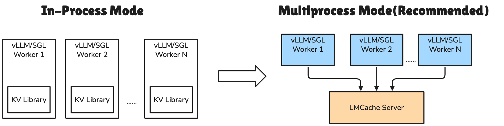
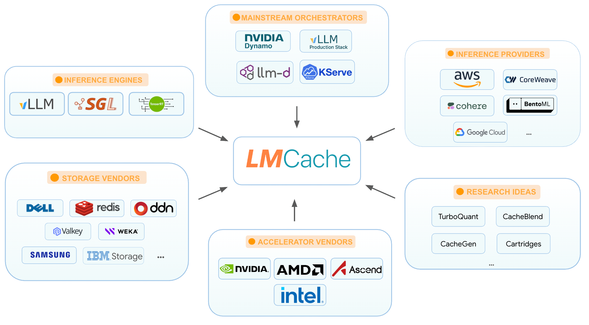
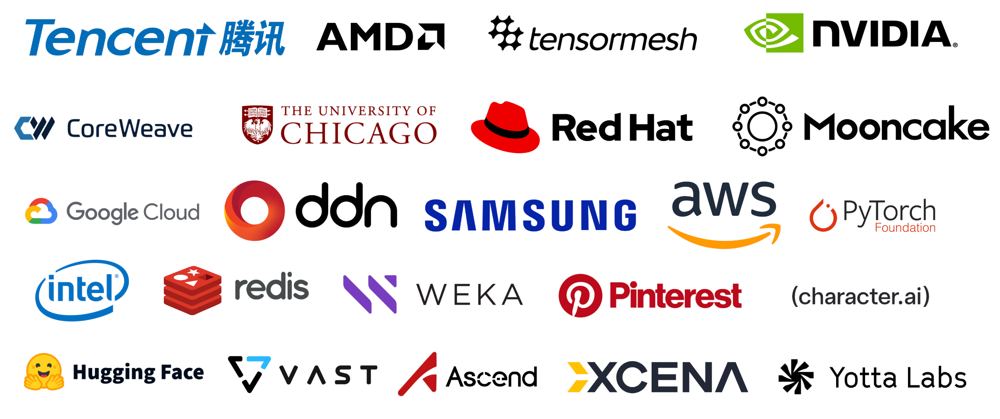

<div align="center">
  <p align="center">
    
  </p>
  <h3 align="center">
    A KV Cache Management Layer for Scalable LLM Inference
  </h3>
    <hr width="78%">

  <h3 align="center">
    <a href="https://blog.lmcache.ai/">Blog</a> |
    <a href="https://docs.lmcache.ai/">Documentation</a> |
    <a href="https://docs.lmcache.ai/community/faq.html">FAQ</a> |
    <a href="https://join.slack.com/t/lmcacheworkspace/shared_invite/zt-3zxjao8h0-lRfBfnLqbALOtLsWn2ITxA">Slack</a> |
    <a href="https://docs.lmcache.ai/community/meetings.html">Community Meeting</a> |
    <a href="https://github.com/LMCache/LMCache/issues/2923">Roadmap</a>
  </h3>

  [](https://github.com/LMCache/LMCache/stargazers)
  [](https://pypi.org/project/lmcache/)
  [](https://pypi.org/project/lmcache/)
  [](https://pypi.org/project/lmcache/)
  [](LICENSE)
  [](https://github.com/LMCache/LMCache/issues?q=is%3Aissue+is%3Aopen+label%3A%22good+first+issue%22)
  [](https://join.slack.com/t/lmcacheworkspace/shared_invite/zt-3zxjao8h0-lRfBfnLqbALOtLsWn2ITxA)
  [](https://deepwiki.com/LMCache/LMCache/)

  ⭐ **If LMCache helps you serve LLMs faster and cheaper, [give us a star](https://github.com/LMCache/LMCache) — it helps more teams discover the project.**

</div>

## Updates

- [2026/06] 🔥 Multi-platform development support with no GPU required ([starter guide](https://blog.lmcache.ai/en/2026/06/23/vllm-lmcache-a-starter-guide-no-gpu-required/), [MP transfer paths](https://blog.lmcache.ai/en/2026/06/15/understanding-lmcache-mp-mode-transfer-paths-a-beginners-guide/)).
- [2026/05] 🔥 Agentic workload benchmark on AMD MI300X ([blog](https://blog.lmcache.ai/en/2026/05/12/benchmarking-lmcache-for-multi-turn-agentic-workloads-on-amd-mi300x/)).
- [2026/04] 🔥 New multiprocess (MP) architecture, the recommended deployment mode ([blog](https://blog.lmcache.ai/en/2026/04/03/lmcaches-new-architecture-boosts-moe-inference-performance-by-10x/)).
- [2026/03] LMCache at GTC 2026 ([post](https://www.linkedin.com/posts/lmcache-lab_llm-opensource-nvidiagtc-activity-7442721875664826369-pMAu)).
- [2026/01] Multi-node P2P CPU memory sharing, from experimental to production ([blog](https://blog.lmcache.ai/en/2026/01/21/p2p-1/)).

<details>
<summary>Earlier updates</summary>

- [2025/11] LMCache x CoreWeave accelerate efficient LLM inference for Cohere ([blog](https://blog.lmcache.ai/en/2025/10/29/breaking-the-memory-barrier-how-lmcache-and-coreweave-power-efficient-llm-inference-for-cohere/)).
- [2025/10] LMCache joins the PyTorch Foundation ([blog](https://blog.lmcache.ai/en/2025/10/31/tensormesh-unveiled-and-lmcache-joins-the-pytorch-foundation/), [PyTorch](https://pytorch.org/blog/lmcache-joins-pytorch-ecosystem/)).
- [2025/09] NVIDIA Dynamo integrates LMCache ([blog](https://blog.lmcache.ai/en/2025/09/18/nvidia-dynamo-integrates-lmcache-accelerating-llm-inference/)).
- [2025/08] LMCache supports gpt-oss (20B/120B) on day 1 ([blog](https://blog.lmcache.ai/en/2025/08/05/lmcache-supports-gpt-oss-20b-120b-on-day-1/)).
- [2025/07] LMCache with Redis ([Redis blog](https://redis.io/blog/get-faster-llm-inference-and-cheaper-responses-with-lmcache-and-redis/)); multimodal models in vLLM V1 ([blog](https://blog.lmcache.ai/en/2025/07/03/lmcache-extends-its-turbo-boost-to-multimodal-models-in-vllm-v1/)).

</details>

## About

LMCache is a **KV cache management layer** for LLM inference. It turns the KV cache from temporary per-request state into reusable knowledge: it is **stored** persistently, **reused** across requests and serving engines, **monitored** with an observability stack, and **transformed** for better generation quality. The result is lower **TTFT** (time-to-first-token) and higher throughput, especially for long-context, multi-turn, agentic, and RAG workloads.

LMCache runs as a standalone daemon, independent of the inference engine, so cached KV survives an engine restart. It is vendor-neutral: it works with mainstream serving engines, hardware vendors, and storage systems, and lets you switch engines or storage while reusing stored caches.

<p align="center">
<picture>
  <source media="(prefers-color-scheme: dark)" srcset="asset/deployment_modes_dark.png">
  <source media="(prefers-color-scheme: light)" srcset="asset/deployment_modes_light.png">
  
</picture>
</p>

### Key features

- **Standalone multiprocess (MP) mode**: LMCache runs as its own server (`lmcache server`) and engines attach to it, so the cache is not lost when an engine crashes and one cache can be shared by several engine instances. MP is the recommended mode. The earlier in-process mode is documented under [Legacy](https://docs.lmcache.ai/legacy/index.html).
- **Tiered offloading and reuse**: KV caches move from GPU memory to CPU RAM, local disk, and remote backends, so prefill computation is reused across requests, sessions, and instances.
- **Pluggable storage backends**: CPU RAM, local disk / filesystem, DAX (CXL-style memory), Redis, Valkey / RESP, Mooncake, InfiniStore, S3-compatible object storage, NIXL, GDS, and HFBucket. Custom backends implement one interface.
- **Non-prefix reuse with CacheBlend**: reuse cached KV at any position in the prompt, recomputing a narrow band of tokens to recover quality ([EuroSys 2025](#citation)).
- **Prefill / decode disaggregation**: KV transfer from prefill to decode workers over NVLink, RDMA, or TCP through NIXL (1P1D and XpYd topologies).
- **Compression and transformation**: CacheGen compression and streaming, token dropping, and custom serialization through the SERDE interface.
- **Observability**: Prometheus metrics for token-level and request-level prefix cache hits, tracing for transfer paths, and a cache event stream for fleet-wide cache directories.
- **Cache operations**: look up, pin, move, clear, and compress cached KV on a running server, through the CLI, HTTP, or the KV cache SDK.
- **Production deployment**: Docker, Kubernetes, and a Kubernetes operator; Dynamo coordination.

LMCache is becoming an integral layer of the LLM inference ecosystem, with community-driven integrations:

<p align="center">
  
</p>

### Supported engines and hardware

| Area | Supported |
|---|---|
| **Engines** | vLLM (MP and in-process), SGLang (MP only), NVIDIA Dynamo |
| **Hardware** | NVIDIA CUDA (12.1+, compute capability 7.0+), AMD ROCm (MI300X/MI325X, MI350X/MI355X), Intel XPU, MetaX MACA |

Not every vLLM release, model, or storage backend is validated against every LMCache release. See the [compatibility matrix](https://docs.lmcache.ai/getting_started/compatibility.html) before you pick versions.

## Getting Started

Prerequisites: Linux, Python 3.10–3.14, and a supported accelerator (see above). Install and try MP mode with vLLM:

```bash
uv venv --python 3.12
source .venv/bin/activate
uv pip install lmcache vllm
```

Start the LMCache server (`--l1-size-gb` sets the CPU-memory cache size):

```bash
lmcache server --host localhost --port 5555 --l1-size-gb 20 --eviction-policy LRU
```

In another terminal, start vLLM with the MP connector:

```bash
vllm serve Qwen/Qwen3-8B \
    --port 8000 --kv-transfer-config \
    '{"kv_connector":"LMCacheMPConnector", "kv_role":"kv_both", "kv_connector_extra_config": {"lmcache.mp.host": "localhost", "lmcache.mp.port": 5555}}'
```

Send two requests that share a prefix: the second one reuses the cached KV.

For the full walkthrough (SGLang, in-process mode, and verification), see:
- [Installation](https://docs.lmcache.ai/getting_started/installation.html) (pip, uv, Docker, source; CUDA, ROCm, XPU, and MACA channels)
- [Quickstart](https://docs.lmcache.ai/getting_started/quickstart.html)
- [Model recipes](https://docs.lmcache.ai/recipes/index.html) with tested configurations per model
- [CLI reference](https://docs.lmcache.ai/cli/index.html) and [MP configuration](https://docs.lmcache.ai/mp/configuration.html)
- [Benchmarking guide](https://docs.lmcache.ai/getting_started/benchmarking.html): how to measure TTFT and throughput, and reproduce published numbers
- [Production deployment](https://docs.lmcache.ai/production/index.html)

## Documentation

The documentation at [docs.lmcache.ai](https://docs.lmcache.ai/) tracks the `dev` branch. Tagged releases are published under versioned paths, and a Chinese translation is under `/zh_CN/`. The source lives in [`docs/source`](docs/source); design notes are in [`docs/design`](docs/design).

## Repository layout

| Path | Contents |
|---|---|
| `lmcache/` | Python package: CLI, MP server, storage backends, engine integrations |
| `csrc/`, `rust/` | C++/CUDA kernels and Rust components |
| `examples/` | Runnable examples (disaggregated prefill, token dropping, cache reuse, and more) |
| `benchmarks/` | Workload generators: long-doc QA, multi-round QA, RAG, and microbenchmarks |
| `tests/` | Unit and integration tests |
| `docker/`, `operator/` | Container images and the Kubernetes operator |

## Contributing

Contributions are welcome. Read the [Contributing Guide](https://docs.lmcache.ai/developer_guide/contributing.html), then join the [Slack community](https://join.slack.com/t/lmcacheworkspace/shared_invite/zt-3zxjao8h0-lRfBfnLqbALOtLsWn2ITxA) or the [community meeting](https://docs.lmcache.ai/community/meetings.html).

## Adoption and Partnerships

LMCache has a growing community of developers, researchers, industry adopters, and partners. Its continued development is supported in part by [Tensormesh](https://www.tensormesh.ai/).

<p align="center">
  <picture>
    <source media="(prefers-color-scheme: dark)" srcset="asset/partner_dark.png">
    <source media="(prefers-color-scheme: light)" srcset="asset/partner_light.png">
    
  </picture>
</p>

## Citation

If you use LMCache in research, please cite the LMCache paper and the related work below.

~~~bibtex
@article{cheng2025lmcache,
  title={LMCache: An Efficient KV Cache Layer for Enterprise-Scale LLM Inference},
  author={Cheng, Yihua and Liu, Yuhan and Yao, Jiayi and An, Yuwei and Chen, Xiaokun and Feng, Shaoting and Huang, Yuyang and Shen, Samuel and Du, Kuntai and Jiang, Junchen},
  journal={arXiv preprint arXiv:2510.09665},
  year={2025}
}
~~~

<details>
<summary>Related papers</summary>

~~~bibtex
@inproceedings{liu2024cachegen,
  title={Cachegen: Kv cache compression and streaming for fast large language model serving},
  author={Liu, Yuhan and Li, Hanchen and Cheng, Yihua and Ray, Siddhant and Huang, Yuyang and Zhang, Qizheng and Du, Kuntai and Yao, Jiayi and Lu, Shan and Ananthanarayanan, Ganesh and others},
  booktitle={Proceedings of the ACM SIGCOMM 2024 Conference},
  pages={38--56},
  year={2024}
}

@inproceedings{yao2025cacheblend,
  title={Cacheblend: Fast large language model serving for rag with cached knowledge fusion},
  author={Yao, Jiayi and Li, Hanchen and Liu, Yuhan and Ray, Siddhant and Cheng, Yihua and Zhang, Qizheng and Du, Kuntai and Lu, Shan and Jiang, Junchen},
  booktitle={Proceedings of the twentieth European conference on computer systems},
  pages={94--109},
  year={2025}
}
~~~

</details>

## License

LMCache is licensed under the Apache License 2.0. See [LICENSE](LICENSE).
