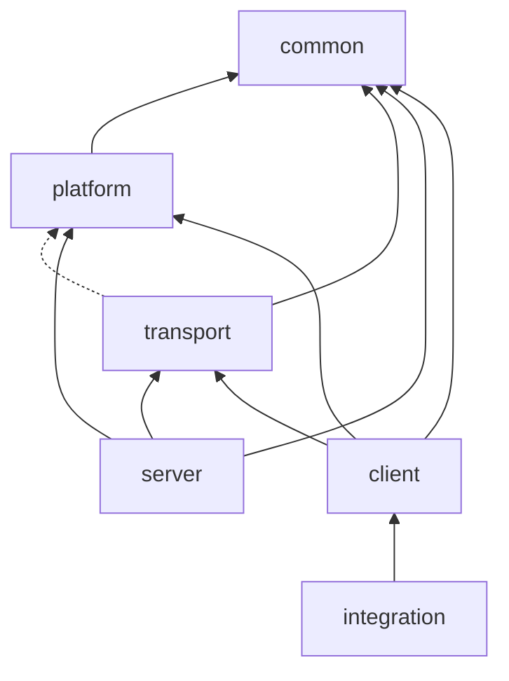

# Module Dependencies

LMCache code is split into six parts. Each part may import only the parts its
arrows point to. `tools/check_module_deps.py` enforces this in pre-commit and CI,
and fails if this page and the check disagree.

The dotted arrow means transport uses devices such as IPC wrappers on demand. The
check treats it like a solid arrow.

| Part | Package | May import |
|---|---|---|
| common | `lmcache.v1.common` | nothing |
| platform | `lmcache.v1.platform` | common |
| transport | `lmcache.v1.transport` | common, platform |
| server | every other module under `lmcache` | common, platform, transport |
| client | `lmcache.v1.client` | common, platform, transport |
| integration | `lmcache.integration` | client |

Imports within a part are always allowed. Server and client never import each
other, and nothing imports integration. The rules are about import statements;
`lmcache/__init__.py` imports platform, so at run time every lmcache import
loads platform.

A few modules need a placement the table does not spell out:

- `lmcache/__init__.py` runs on every lmcache import and re-exports platform
  values, so it is checked as platform, and anything imported from it
  (`from lmcache import torch_dev`) counts as platform.
- `lmcache/v1/__init__.py` runs whenever any part under `lmcache.v1` is imported,
  so it is checked as common and may import nothing.
- Modules without a source file are placed in `EXTRA_MODULES` in the check:
  `lmcache_native` and the generated `_version` are common, the device
  extensions `cuda_ops`, `musa_ops` and `xpu_ops` are platform, and the separate
  `lmcache.inprocess` distribution is outside the tree. A new extension counts
  as server until it is added there.

## What counts as an import

- Every `import` and `from ... import` in a `.py` file under `lmcache/`,
  including relative imports, imports inside functions, and imports inside
  `if TYPE_CHECKING:` blocks.
- Attribute chains on an imported `lmcache`, such as `lmcache.v1.client.x.run()`.
- `importlib.import_module(...)` and `__import__(...)`, also under another name
  (`import importlib as il`). The target comes from the literal module name and
  `__import__`'s literal `fromlist`, or from the literal prefix of an f-string
  when that prefix lies inside one part (`f"{__package__}.{name}"` stays in the
  caller's package; `f"lmcache.v1.{name}"` does not count).
- Any other use of those functions, such as an unresolved target, assigning
  `importlib.import_module` to a variable, or `getattr(importlib,
  "import_module")`, fails unless the same or previous line has
  `# module-deps: allow -- <reason>`. One comment covers one use.

## Existing violations

`tools/module_deps_baseline.txt` lists the imports that break the tree today, one
`importer -> imported` per line, plus the uses of import functions whose target
the check cannot resolve, as `importer -> <dynamic: code>`. Some of the latter
load modules the tree allows; they are listed because the check cannot tell.

The check fails on any violation that is not in the list, and on any line in the
list that no longer occurs. After fixing one, run
`python tools/check_module_deps.py --prune` to drop its line.

Do not add a line to get a new import past the check. Move the shared definition
into a part that both sides may import instead, usually common.

## Limits

- A dynamic import whose target is built at run time is only as safe as the
  reason given in its allow comment.
- These are not checked: `importlib.util.find_spec` and `spec_from_file_location`,
  `runpy`, `exec` and `eval`, `sys.modules` lookups, `builtins.__dict__`, and
  entry points.
- A part can re-export what it imports. For example, integration can reach a
  common name through client without breaking the tree.
- The check reads the files on disk, so a local untracked file under `lmcache/`
  is checked too.
- Draft pull requests skip pre-commit, so the check runs once a PR is ready for
  review.
