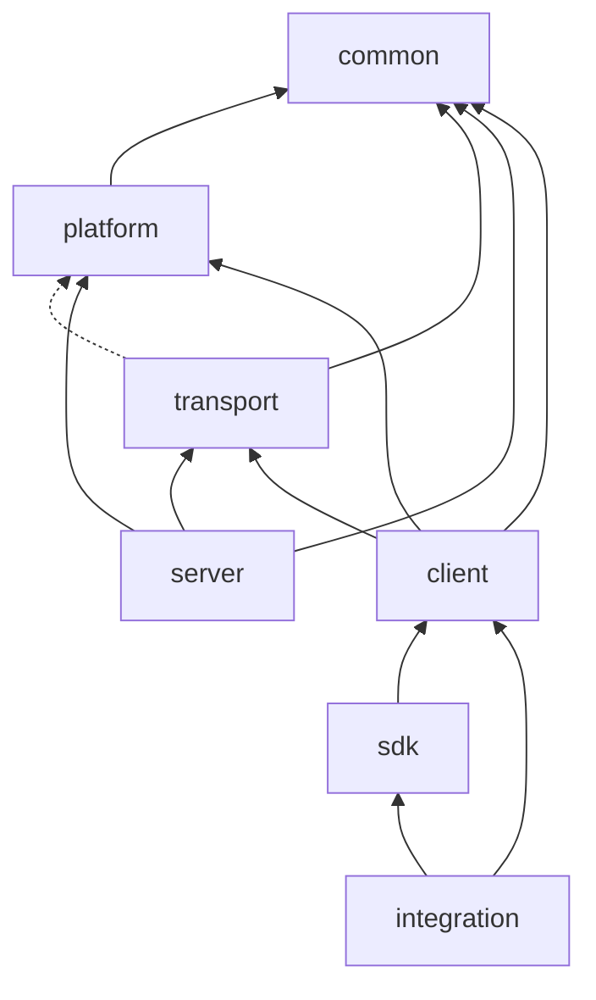

# Module Dependencies

LMCache code is split into seven parts. Each part may import the parts its arrows
lead to, directly or through other parts: integration may import common, since
integration depends on client and client on common. The rules live in one file,
`tools/module_deps.yaml`, and `tools/check_module_deps.py` enforces them in
pre-commit and CI.

The dotted arrow means transport uses devices such as IPC wrappers on demand. The
check treats it like a solid arrow, and fails if this diagram and the rules file
disagree. It also fails if the arrows form a cycle.

Imports within a part are always allowed. Server and client never import each
other, sdk never imports server, and nothing imports integration except through
the exceptions below. Server is
every lmcache module that is not in another part. `lmcache.cli` is outside the
diagram, is not server and is not checked.

Which packages make up each part, and where the files the diagram does not draw
belong, is in `tools/module_deps.yaml`.

## What counts as an import

- Every `import` and `from ... import`, including relative imports, imports
  inside functions, and imports inside `if TYPE_CHECKING:` blocks.
- Attribute chains on an imported `lmcache`, such as `lmcache.v1.client.x.run()`.
- `importlib.import_module(...)` and `__import__(...)` when the target is a
  literal or an f-string whose literal prefix lies inside one part.

## Exceptions

`exceptions` in the rules file lists the places that break the tree, by part or
package. Today it has one line, `lmcache.sdk.qringbuffer -> integration`, a
known cycle between sdk and integration that goes away once LMCache owns the Q
ring buffer. An exception may form a cycle; the arrows may not. Delete a line once
its imports are fixed; the check fails on a line that matches nothing. Do not add a
line to get a new import past the check. Move the shared code into a part both
sides may import instead, usually common.

## Limits

- A new import inside an excepted part or package passes.
- Dynamic imports whose target is computed at run time, `importlib.util`,
  `runpy`, `exec`, `sys.modules` and entry points are not checked.
- Draft pull requests skip pre-commit, so the check runs once a PR is ready for
  review.
