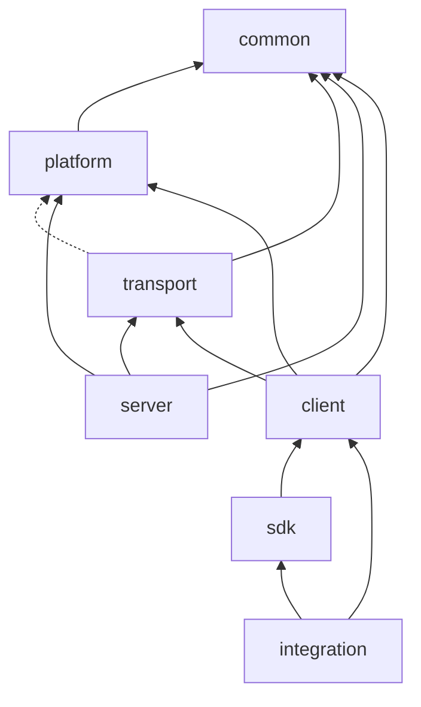

# Module Dependencies

LMCache code is split into seven parts. The public API, `lmcache.sdk`, is separate
from inference-engine adapters in `lmcache.integration`. Each part may import the
parts its arrows lead to, directly or through other parts: SDK may import common,
since SDK depends on client and client on common. The rules live in one file,
`tools/module_deps.yaml`, and `tools/check_module_deps.py` enforces them in
pre-commit and CI.

The dotted arrow means transport uses devices such as IPC wrappers on demand. The
check treats it like a solid arrow, and fails if this diagram and the rules file
disagree.

Imports within a part are always allowed. SDK may import client, common, transport
and platform through the arrows above, but must not import server implementations.
Integration may use SDK; SDK must not depend on engine integrations except for the
existing Q-ring migration exception below. Server and client never import each
other, and no lower part imports SDK.

Server is every lmcache module that is not in another part or explicitly outside
the tree. This includes `lmcache.v1.distributed`, `lmcache.v1.multiprocess`,
`lmcache.v1.mp_coordinator`, `lmcache.v1.storage_backend` and the in-process engine
implementation. `lmcache.cli` is outside the tree and is not checked; SDK is
checked, including its lazy and type-only imports.

Which packages make up each part, and where the files the diagram does not draw
belong, is in `tools/module_deps.yaml`.

## What counts as an import

- Every `import` and `from ... import`, including relative imports, imports
  inside functions, and imports inside `if TYPE_CHECKING:` blocks.
- Attribute chains on an imported `lmcache`, such as `lmcache.v1.client.x.run()`.
- `importlib.import_module(...)` and `__import__(...)` when the target is a
  literal or an f-string whose literal prefix lies inside one part.

## Exceptions

`exceptions` in the rules file lists the places that break the tree, by part or
package. The sole exception is `lmcache.sdk.qringbuffer -> lmcache.integration.vllm`:
the existing worker-side Q capture code uses vLLM layout helpers and metadata
types. That producer code belongs in integration, as its
[design doc](sdk/qringbuffer.md) explains; keeping its migration separate does not
make SDK part of integration or allow SDK to import server code.

Delete an exception once its imports are fixed; the check fails on a line that
matches nothing. Do not add a line to get a new import past the check. Move shared
code into a part both sides may import instead, usually common.

## Limits

- A new import inside an excepted part or package passes.
- Dynamic imports whose target is computed at run time, `importlib.util`,
  `runpy`, `exec`, `sys.modules` and entry points are not checked.
- Draft pull requests skip pre-commit, so the check runs once a PR is ready for
  review.
