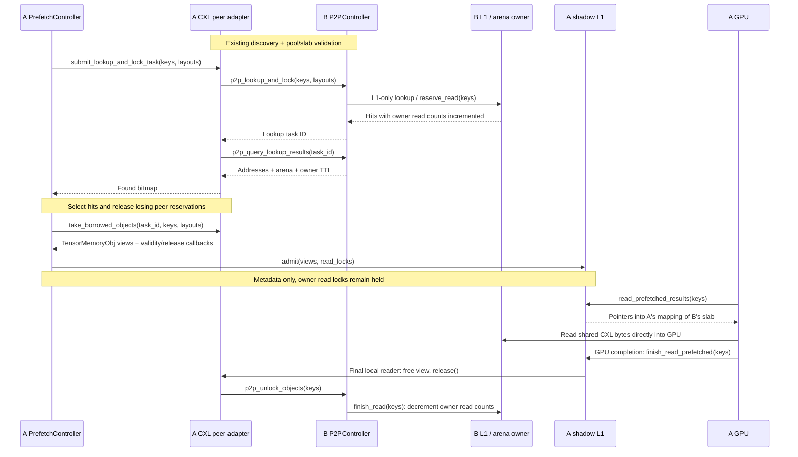

# Shared CXL KV sharing through a shadow L1

Nodes A and B map one shared CXL pool and own disjoint slabs. A borrows B's
read-locked chunk, admits a view of it into A's shadow L1, and reads B's bytes
directly into its GPU. Admission uses metadata only: no local payload
allocation, capacity check, DRAM staging, or CXL-to-CXL copy. B remains the
allocation owner.

## Shadow L1

The read path (lookup, read locks, `finish_read`, eviction, events) only
serves objects an L1 manager indexes, so a borrowed view must live in some L1.
It lives in a dedicated `ShadowL1Manager`, not in an L1 that owns payload, so
the shared `BaseL1Manager` carries no borrowing logic:

```
BaseL1Manager             shared state machine (index, locks, events)
 ├── DramL1Manager
 ├── DevDaxL1Manager       owner side: cxl_arena, get_cxl_address
 ├── GdsL1Manager
 └── ShadowL1Manager       borrowed views only; no payload, no capacity
       └── ShadowL1MemoryManager   allocate: refused; free(obj): obj.release()

L2 adapter that lends views (CxlPeerL2Adapter)
 └── BorrowedTensorMemoryObj   is_valid(): lease holds; release(): end lease
```

- **Lender** (L2 adapter): owns the bytes' lifetime. It maps the peer slab,
  creates `BorrowedTensorMemoryObj` views whose lease is the owner's read
  reservation, and sends the owner unlock when a view is released.
- **Shadow L1**: indexes views by key. `admit(objects, read_locks)` makes them
  resident and read-locked in one locked pass; a duplicate or expired view is
  released. Freeing a view (last `finish_read`, delete, eviction, close) ends
  its lease. It knows nothing about CXL.
- **Base class**: one generic rule, an object whose `is_valid()` is False is
  not readable (`reserve_read`, `unsafe_read`).
- **Prefetch controller**: borrows exactly when an adapter's L1 affinity is a
  shadow L1, and admits the adapter's views there.

The factory pairs one shadow L1 with each Device-DAX L1 that owns a CXL slab,
after the configured L1s. It reports the paired L1's backend and segment as
`REMOTE` (`(CXL, REMOTE)` here), holds 0 bytes, and is excluded from write
placement. A future lender, e.g. RDMA reads from a peer's DRAM into GPU
memory, would add its own borrowed-object type and a shadow L1 paired with
the DRAM L1, without changing the L1 managers.

## Modules and reuse

Paths are relative to `lmcache/v1/`. New production modules are the CXL peer
adapter and the shadow L1 manager and its memory manager.

| Module | Responsibility |
| --- | --- |
| **New:** `distributed/l2_adapters/cxl_peer_l2_adapter.py` | Extend `PeerL2AdapterBase` (shared with `P2PL2Adapter`): turn lookup reservations into ordinary tensor views with validity/release callbacks. |
| `distributed/l2_adapters/p2p_l2_adapter.py` | Common peer-region registration/teardown, RPC setup, lookup/polling/timeouts, and acknowledged unlock. |
| `memory_allocators/devdax_memory_allocator.py`, `distributed/memory_manager/devdax_l1_memory_manager.py` | Existing owned-slab allocation plus shared mapping helper and peer mapping. Peer views never enter local allocator/free lists. |
| **New:** `distributed/l1_manager/shadow.py`, `distributed/memory_manager/shadow_l1_memory_manager.py` | Index borrowed views without payload; freeing a view ends its lease. |
| `memory_management.py` | `BorrowedTensorMemoryObj`: a `TensorMemoryObj` view under a lease. |
| `distributed/l1_manager/base.py` | Invalid objects are not readable; no borrowing logic. |
| `distributed/l1_manager/devdax.py`, `distributed/l1_manager/factory.py`, `distributed/storage_manager.py` | Export owned slab addresses (Device-DAX), pair a shadow L1 with a CXL slab, keep writes out of shadow L1s, and release views before adapter teardown. |
| `distributed/l2_adapters/base.py`, `distributed/storage_controllers/prefetch_controller.py` | Adapters bound to a shadow L1 lend views; the controller admits them instead of reserving destination capacity and copying. |
| `distributed/internal_api.py`, `distributed/transfer_channel/api.py`, request codecs | Arena identity and payload-relative addresses, carried by existing ZMQ/gRPC messages. |
| `multiprocess/modules/p2p_controller.py`, coordinator registration | Existing discovery, heartbeat, owner read counts/TTL, and adapter draining, with pool/session validation. |
| `multiprocess/modules/lmcache_driven_transfer.py`, `multiprocess/object_group_transfer.py` | Existing GPU retrieval and completion callbacks. |

## Peer identity and addressing

`CxlArenaDescriptor` contains `pool_id`, `offset` (slab-header byte offset),
`size` (payload bytes), `alignment` (also header length), and `session_id`.
The owner advertises it as JSON under coordinator metadata `lmcache.cxl.arena`
and writes its SHA-256 fingerprint into the slab header at startup.

Eligible peers share a pool ID and have disjoint slab ranges. The borrower
checks the mapped fingerprint before accepting a peer and serving its views;
this detects incorrect mappings and owner restarts, but is not authentication.
Only the primary owned CXL slab is exported. DRAM, extra arenas, and borrowed
shadows return misses; owner L1 remains the authoritative key index.

The shared `MemoryRegionAddress` carries payload-relative `offset`, `size`,
optional `cxl_arena`, and `read_ttl_seconds`. It aliases `TransferChannelAddress`
and preserves its serialized fields (including `cxl_ttl_seconds`) for existing
ZMQ/gRPC peers. B's virtual address never crosses the wire:

```text
A_local_pointer = A_mapping_of_B_slab + B.alignment + chunk.offset
```

With 4096-byte alignment and payload offset 8192, A reads at its mapping base
plus 12288. The mapping retains a `memoryview` so live tensor views prevent
unmapping; it creates no allocator or transfer channel.

## Function contracts

| Function / owner | Input | Output / ownership |
| --- | --- | --- |
| `_register_peer_region()` / P2P adapter | Adapter's constructor config | Once per connection: import the registered RDMA region or map/GPU-register the CXL slab. The adapter itself scopes region-relative addresses. |
| `_unregister_peer_region()` / P2P adapter | Drained adapter, called by `close()` | Release RDMA resources or unmap CXL after borrowed readers and unlocks drain; RPC stays open if draining fails. |
| `cxl_arena` / Device-DAX L1 and storage manager | Property | Owned `CxlArenaDescriptor`, or `None`. |
| `get_cxl_address(obj)` / Device-DAX L1 and storage manager | Read-reserved `MemoryObj` | Owned primary-slab address and TTL, or `None` (including any object in a shadow L1). |
| `CxlPeerMapping(device_path, arena)` | Local pool device path, peer descriptor | GPU-registered mapping; invalid identity or failed registration raises an error. |
| `CxlPeerMapping.view(offset, size)` | Payload-relative byte range | Tensor byte view; invalid bounds/alignment/session raises `ValueError`. |
| `add_cxl_peer(arena, request_url, lookup_timeout)` / storage manager | Peer descriptor, RPC endpoint, deadline seconds | Adapter ID using existing registration/draining. |
| `take_borrowed_objects(task_id, keys, layouts)` / L2 adapter | Completed lookup, selected keys, layouts by group | Key → `BorrowedTensorMemoryObj`; copy adapters raise `NotImplementedError` (only adapters bound to a shadow L1 are asked). Invalid hits remain releasable via `release_lookup`. |
| `admit(objects, read_locks)` / shadow L1 | Views by key, reader count | Per key `(SUCCESS, resident object)`; a concurrent resident wins and the new view is released; `KEY_IN_WRONG_STATE` for a view that expired before admission; `KEY_NOT_READABLE` when the resident view expired but readers still hold it. |
| `release_lookup(task_id, keys)` / L2 adapter | Lookup identity, unused keys | Return only unadopted reservations. Adopted views release independently. |
| `BorrowedTensorMemoryObj.is_valid()` | None | Reservation unreleased, within owner TTL, and mapped session current. |
| `BorrowedTensorMemoryObj.release()` | Called by the shadow L1 when the view is freed | Idempotently invalidate the view and enqueue its owner unlock; a worker sends everything queued since its last RPC as one unlock RPC. Takes no lock, so it is safe in a garbage-collection finalizer. No payload free or blocking RPC under L1 locks. |
| `reap_expired()` / shadow L1 | None | Reclaim expired/session-invalid views that no reader holds. An expired, read-locked shadow becomes unreadable at once and is released by its last `finish_read` (or when the local read lock's TTL lapses). |
| `get_active_borrow_count()` / adapter | None | Live views plus pending unlock operations; removal waits for zero. |

## Remote P2P lookup and retrieval



## Lifetime and deployment limits

Registration lasts for the peer connection; read reservations last for individual
retrievals. RDMA unlock follows the copy into local DRAM, whereas CXL unlock follows
the final GPU read. Both use `peer_rpc_url` for lookup/unlock; configuration also
accepts the existing `peer_mq_server_url` name. Registration failure closes RPC
and notifier resources, and successful adapter close is idempotent.

Each lookup holds independent owner read counts, scoped locally by task ID.
Multiple local readers share one shadow reservation until their final GPU
completion. Failed admission, unused hits, and cancellation release reservations;
`weakref.finalize` also releases an unadmitted view when it is garbage-collected.
Peer removal drains lookups, shadows, and queued unlocks before unmapping.
Unlocks are batched, so an unreachable owner costs one RPC timeout per batch;
an owner that closes its slab clears the header, so borrowers stop trusting
it at once instead of waiting for the TTL.

Local expiry is lookup-submission time plus owner TTL, minus a safety margin of
`min(1 s, TTL / 10)`; local reader increments cannot extend it. Validity is
re-checked when a reader takes the shadow (`unsafe_read`), but a GPU copy that
passed that check keeps reading afterwards. The margin is how long that copy
has to finish before the owner may free and reuse the bytes. For example, with
a 300 s TTL a view stops being handed out 299 s after the lookup was sent.
An expired shadow is never handed to a new reader, but one a reader already
holds keeps its mapping until that reader's `finish_read`, so a GPU copy in
flight is never torn down. Admission that races expiry is an ordinary miss,
and the prefetch controller counts only keys admitted with SUCCESS (for
borrowed views and copy loads alike) as read-locked. Routing a `finish_read`
needs the prefetch result's `l1_owners` (which serving passes): without them
`StorageManager` probes L1s for readable objects and cannot find an expired
view, which is then reclaimed when its local read lock's TTL lapses.
Expired or restarted-owner reservations do not send unlocks; an unlock skipped
inside the margin leaves the owner lock to its own TTL, which errs safe. Key-only unlocks
retain existing delayed-message/TTL limitations; there is no distributed fencing
or recovery from an owner failure during DMA.

Enable `--p2p-transfer-engine cxl` and `--cxl-pool-id POOL` on top of the
Device-DAX L1 settings, with `--l1-devdax-offset-gb` placing this node's slab,
and a coordinator;
see [P2P configuration](../../source/mp/p2p.rst). No P2P advertise URL is needed.
Reserve `alignment + payload_size` bytes per slab: two 2-GiB payloads with
2-MiB headers start at 0 and 2149580800 bytes (`--l1-devdax-offset-gb
2.001953125`) and need 4299161600 shared bytes.
Deployment assigns non-overlapping slabs and must not reinitialize them with
active readers. Device paths may differ between nodes.
The shared API does not enable concurrent RDMA/CXL discovery. CXL mode requires
exactly one L1, the Device-DAX slab with `--cxl-pool-id` (the server refuses to
start otherwise; the shadow L1 is created automatically, not configured). The
peer adapter asks for the (CXL, REMOTE) memory tag, so borrowed views are
admitted into the shadow L1.
`--l1-align-bytes` sets the header length, so it must be a multiple of the
device alignment (2 MiB on most Device-DAX devices); mapping fails with a
message naming the required value otherwise.

Tests cover distinct mappings of one shared file, ZMQ/gRPC, GPU copies when
available, a full borrower slab, independent borrows, duplicate admission,
expiry, and draining. Cross-host CXL coherency, DMA performance, and failure
recovery still require hardware validation.
