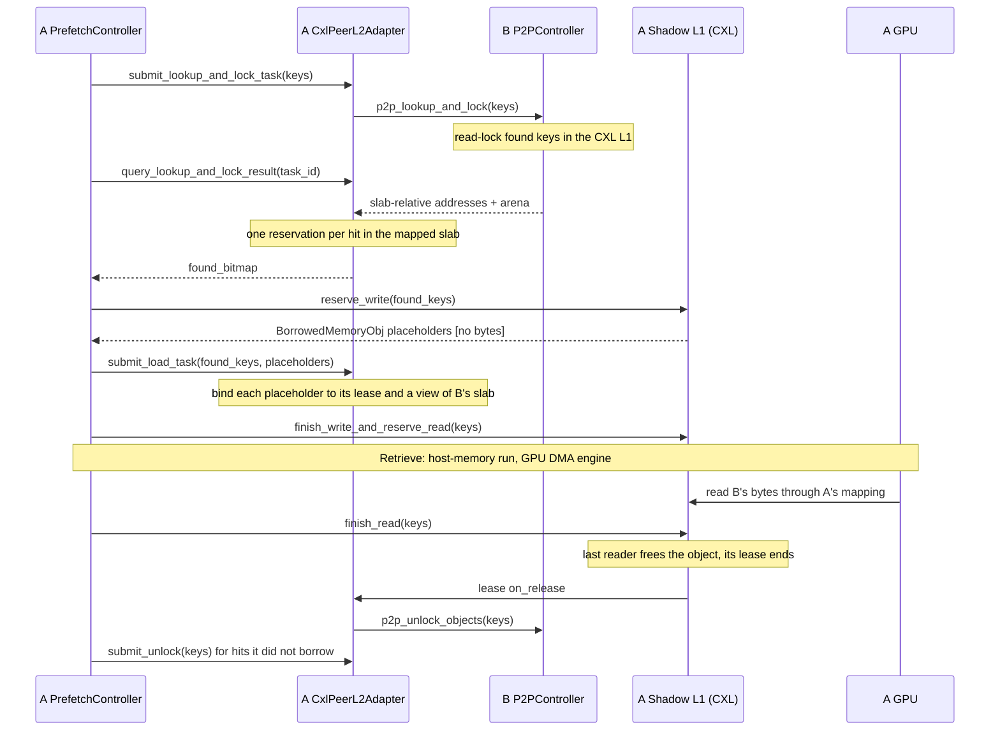

# Shared-Pool CXL Borrowing Peer Adapter

`lmcache/v1/distributed/l2_adapters/cxl_peer_l2_adapter.py`,
`BorrowingPeerL2AdapterBase` in `lmcache/v1/distributed/l2_adapters/p2p_l2_adapter.py`,
`CxlPeerMapping` in `lmcache/v1/memory_allocators/devdax_memory_allocator.py`

**Experimental**: validated against a file-backed mock pool, not real
multi-host CXL.

Nodes that map one shared CXL pool each own a disjoint slab of it (their
Device-DAX L1). The CXL peer adapter **borrows** a peer's object, as the GDR
adapter does ([`gdr_peer_l2_adapter.md`](gdr_peer_l2_adapter.md)): the owner
keeps its read lock and a shadow L1 indexes the object. The difference is the
bytes: this host maps the owner's slab, so a borrowed object is a view of the
owner's bytes and no transfer happens between hosts.

```
--p2p-load-mode gdr (borrow over RDMA)              --p2p-transfer-engine cxl (borrow in place)
lookup:   owner read-locks; shadow indexes a handle lookup:   owner read-locks; shadow indexes a view
retrieve: owner DRAM ─RDMA─► GPU slot ─► paged KV    retrieve: owner slab (mapped here) ─PCIe─► GPU
unlock:   after the last local reader               unlock:   after the last local reader
```

Enable with `--p2p-transfer-engine cxl --cxl-pool-id <id>` on a Device-DAX L1
(`--l1-devdax-path`, `--l1-devdax-offset-gb` placing this node's slab) and a
coordinator; no advertise URL. The server adds the CXL shadow L1
(`shadow.cxl`, [`../l1_manager/l1-manager-types.md`](../l1_manager/l1-manager-types.md))
when none is configured. `cxl` excludes `--enable-p2p-write` and
`--p2p-load-mode gdr`, and requires the slab to be the only L1 that owns
memory (peers can read nothing else).

## Classes

`CxlPeerL2Adapter` extends `BorrowingPeerL2AdapterBase`; reservations, the
load that binds the shadow L1's placeholders, the lease TTL and the unlocks
are the base's and are described in the GDR doc. This class adds only:

| Hook | What it does |
| --- | --- |
| `_register_peer_region` | `CxlPeerMapping`: map the peer's slab from the local device path, check the identity header, GPU-register (pin) the mapping. |
| `_process_lookup_result` | Refuse a hit whose `cxl_arena` is not the mapped incarnation of the peer's slab and return its owner lock at once; the rest become reservations. |
| `_bind_borrowed_object` | `obj.bind(lease, local_view=mapping.view(offset, size), ...)`. The lease additionally requires the mapped header to still be current. |
| `_unregister_peer_region` | Return unborrowed reservations, then unpin and unmap. Raises while a lease is live (`RuntimeError`) or a reader still references a view (`BufferError`); the P2P controller retries the removal every discovery cycle. |

`read_window_s` (default 5 s, adapter config) is the lease time a read
needs left to start: a read from the mapping is a host/GPU copy queued at
retrieve and finished asynchronously, so a view is valid only while the
owner's lock is held for at least that long afterwards. Together with the
base's TTL margin (`min(1 s, TTL / 10)`), a copy queued for longer than the
window can still read reused bytes; the window must exceed the worst-case
copy latency. As with GDR, **every node must use the same
`--l1-read-ttl-seconds`**; the borrower bounds a lease with its own.

## Local views

`BorrowedMemoryObj.bind` takes exactly one of `read_into` (GDR: bytes are
read into a device region at retrieve) and `local_view` (CXL: a `uint8`
tensor over the owner's bytes mapped into this process). With a local view:

- `raw_tensor`, `tensor`, `get_tensor`, `byte_array` and `data_ptr` return the
  view, so the object is a host-memory object to every copy path.
- `is_local` is True and `select_engine` picks `GPU_DMA`, not `NIC_DMA`: the
  direct copy, native plan and staged loop all apply, and no staging buffer
  is registered with a transfer channel.
- `release()` drops the view, so the mapping can be closed once no reader
  holds a tensor of it.

## Slab identity and addressing

`CxlArenaDescriptor` (`lmcache/v1/common/transfer_channel/api.py`) holds
`pool_id`, `offset` (slab header offset in the device), `size` (payload
bytes), `alignment` (also the header length) and `session_id` (fresh each
time the owner opens the slab). The owner:

- writes the descriptor's SHA-256 fingerprint into the slab header at startup
  and zeroes it on close;
- advertises the descriptor as JSON under coordinator metadata
  `lmcache.cxl.arena` (`CXL_METADATA_KEY`);
- answers lookups with `TransferChannelAddress(offset, size, cxl_arena)`,
  `offset` relative to the slab payload. Its virtual address never crosses
  the wire:

```text
local_pointer = local_mapping_of_peer_slab + peer.alignment + address.offset
```

The borrower accepts a peer in the same pool with a disjoint slab, checks the
mapped fingerprint before serving it, and re-checks it on every lease
validity check. A restarted owner therefore invalidates every view of its
previous incarnation at once and discovery replaces the adapter (the
descriptor changed). The fingerprint detects wrong mappings and restarts; it
is not authentication.

Only the owned slab of the one CXL L1 is exported: the P2P controller serves
`(CXL, LOCAL)` under this engine, so a borrowed view (`(CXL, SHADOW)`) is
never re-exported.

## Flow



## Lifetime and failures

| Event | Behavior |
|---|---|
| Lookup hit in another slab, or the owner restarted | Reported as a miss. The owner lock is returned at once, unless the owner restarted (it no longer holds the lock). |
| Hit the prefetch controller does not load | `submit_unlock` returns its reservation. |
| Address outside the mapped slab, or size differing from the layout | The load reports a miss for the key; `submit_unlock` returns the reservation. |
| Lease expired (`lookup start + read TTL - margin - read window`) | The view is invalid: `unsafe_read` answers `KEY_NOT_READABLE` and the key is a miss. No unlock is sent; the owner's TTL reclaims the lock. |
| Owner closes or restarts its slab | The header no longer matches, so every view of that incarnation is invalid at once. A GPU copy already queued keeps reading the mapped bytes. |
| Last local reader finishes | The shadow L1 frees the view; the lease ends and one unlock RPC is fired without waiting for the answer. |
| Owner unreachable for unlocks | The unlock is lost; the owner's TTL reclaims the lock. |
| Peer removed with a live lease, or a tensor of a view still referenced | `close()` raises (`RuntimeError`, `BufferError`) and the slab stays mapped; the P2P controller retries each discovery cycle. |
| Server shutdown | `StorageManager.close` closes the shadow L1s (after synchronizing the GPU devices) before the L2 adapters, so every lease has ended when the adapter unmaps. |

## Deployment

Reserve `alignment + payload_size` bytes per slab: two 2 GiB payloads with
2 MiB headers start at 0 and 2149580800 bytes (`--l1-devdax-offset-gb
2.001953125`) and need 4299161600 shared bytes. `--l1-align-bytes` is the
header length and must be a multiple of the device alignment (2 MiB on most
Device-DAX devices). Slabs must not overlap, and a slab must not be
reinitialized under active readers. Device paths may differ between nodes.
User guide: [P2P](../../../../source/mp/p2p.rst).

## Known limitations

- No fencing: an owner that dies during a GPU copy is not detected until the
  header check of the next lease validity test.
- A view released after its owner restarted still sends its (key-only)
  unlock to the new incarnation, as GDR does; it is harmless unless another
  borrower locked the same key there within the TTL. Read locks carry no
  reservation id, so a late key-only unlock can release a newer borrow of
  the same key (shared with GDR; tracked in issue #5669).
- A node with a shorter read TTL than its borrowers lets them read reused
  bytes; nothing checks TTL equality (shared with GDR).
- Cross-host CXL coherency, DMA performance and failure recovery still need
  hardware validation.

## Tests

- `tests/v1/distributed/l2_adapters/test_cxl_peer_l2_adapter.py`: two storage
  managers on disjoint slabs of one file-backed pool, the owner's real
  `P2PController` answering in process. Covers binding and release, a full
  borrower slab, independent borrows of one key, unborrowed and refused hits,
  expiry, owner restart, refused and retried close, and identity validation.
- `tests/v1/distributed/test_shadow_l1_manager.py`: `BorrowedMemoryObj` bound
  to a local view.
- `tests/v1/multiprocess/test_cxl_peer_discovery.py`: pool filtering, a
  restarted peer, and the CLI flags.
- `tests/v1/multiprocess/test_transfer_engines.py`: a locally mapped borrowed
  object selects GPU DMA.
- `tests/v1/distributed/transfer_channel/test_api.py`: the arena travels with
  an address over msgpack and protobuf.

Not covered: the GPU copy from a view (the tests stop at the host tensor),
the ZMQ and gRPC transports end to end, and real Device-DAX hardware.
