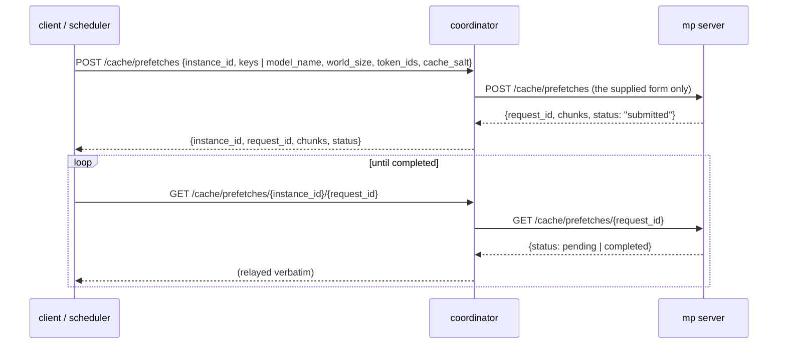

# Coordinator-Controlled L2→L1 Prefetch

## Why

An operator or scheduler that knows a node will soon serve a particular prompt
(a traffic shift, a known-hot shared prefix) needs a way to **pre-warm** that
node's L1 from L2 before the requests land. The coordinator already pushes L2
*evict* to nodes; this adds the symmetric *prefetch* control.

## Flow

A client names **one** registered MP server and either a **token sequence**
(plus the model/world_size and tenant salt) or the **keys** of the chunks to
warm. Token ids always
cover every chunk from position 0, since chunk hashes are prefix-chained; keys
reach a chunk in the middle of a prompt. The coordinator forwards only the
supplied form, so a server that predates the keys form rejects the request
(422) instead of reading empty token fields as a sub-chunk `noop`. The coordinator resolves the target's address from the
registry, `POST`s to its `/cache/prefetches`, and relays the server's
`request_id` back. The client then polls
`GET /cache/prefetches/{instance_id}/{request_id}` on the coordinator, which proxies
the server's status. The warm holds **no read-lock** — completion is reported
reactively and releases nothing; see the warm-prefetch endpoint reference in
`docs/source/mp/http_api.rst` and the coordinator-side flow in
`docs/source/mp/coordinator.rst` for the retain-permanent, no-lock load
lifecycle. There is no background polling on either side: the submit and
status calls are quick and the client drives completion on demand.

## Components

- **`schemas.py`** — `PrefetchRequest {instance_id, keys | model_name,
  world_size, token_ids, cache_salt}` (a `KeysOrTokensRequest`) and
  `PrefetchResponse {instance_id, request_id, chunks, status}`.
- **`controllers/prefetch_manager.py`** — `PrefetchManager`. `submit_prefetch`
  sends the body it is given to the target's `POST /cache/prefetches`, records
  the submit stats and returns the reply;
  `get_status` proxies `GET /cache/prefetches/{request_id}` and relays
  `(status_code, body)`. No fire-and-forget tasks — both calls are quick.
- **`http_apis/cache_api.py`** — `POST /cache/prefetches` and
  `GET /cache/prefetches/{instance_id}/{request_id}`. Each resolves the target
  via `get_context(request).registry.get(instance_id)` (**404** if unknown) and
  uses the shared outbound `httpx.AsyncClient` (`get_outbound_client(request)`);
  a transport error to the target surfaces as **502**. The submit handler
  builds the forwarded body from the request's one form, so the wire format
  stays in the HTTP layer and the controller never sees the request model.

## Keys form on the MP server

`PrefetchService.submit_keys` treats each key as naming its chunk, the way a
pin does. `named_chunks_of_keys` takes the model, world size (unpacked from
`kv_rank`), salt and tags from the keys -- they must agree, or the request is
a 400 -- and the coordinator's `PrefetchRequest` runs the same check, so a
caller's mismatch is a 422 there rather than a relayed 502. It then rebuilds
one row per registered `(object group, kv rank)` from the distinct chunk
hashes. So one key per chunk warms the whole chunk, and every row has the same
length, which the `full` fetch needs. Every row gets no sliding window: the
named chunks need not be a contiguous prefix, so there is no trailing window
to keep, and `full` refuses windowed rows. The tokens form keeps the windows
and so plans nothing for a sliding-window model; making it load the
in-window chunks is left as a follow-up.

## Wiring (`app.py`)

`create_app` builds the `CoordinatorContext` (carrying `prefetch_manager`) and
puts it on `app.state.ctx`. The lifespan stashes the outbound client on
`app.state.ctx.outbound_client` (it previously reached only the background
loops) so request handlers can issue outbound calls.

## Failure modes

- **Unknown `instance_id`** → 404 (synchronous, before any outbound call).
- **Target unreachable / non-2xx submit** → 502 from the coordinator (the
  caller learns the submit failed, unlike a fire-and-forget dispatch).
- **Target has no layout for `(model_name, world_size)`** → the server returns
  503 (`Unavailable`), surfaced to the caller via the 502/proxy path.
- **Client abandons polling** → the server's job lingers as a small handle
  entry (no lock held, no L1 pinned) until polled or swept — see the no-lock
  lifecycle in `docs/source/mp/http_api.rst` (warm-prefetch endpoint).

## Scope

The coordinator only routes submit + status; it does not track which keys a
node already holds or retry. Completion is observed via the status endpoint
(the warm acquires no read-lock, so it emits no `SM_READ_PREFETCHED_FINISHED`;
the load itself still surfaces through the controller's
`L2_PREFETCH_LOAD_COMPLETED` event).

### Single-node vs. multi-node

One `instance_id` is **one node's** MP server, and its L1 is shared with that
node's workers via intra-node CUDA IPC — so it holds only the KV shards for the
`global_rank`s served on that node. Concretely:

- **Single-node deployment** (all `world_size` workers on one box, e.g. TP=8 on
  one node): one instance holds every shard. A single `POST /cache/prefetches`
  warms the whole model's KV for the prompt. **This is the supported case.**
- **Multi-node deployment** (TP/PP spanning nodes): each node holds only its
  slice. A single dispatch warms one node; the caller must warm *each* node's
  `instance_id` to cover the full model. The MP server's all-rank fan-out also
  loads foreign-rank keys that no local worker reads — harmless (best-effort:
  they occupy L1 as unread, retained-but-unlocked entries that eviction
  reclaims under pressure), but not optimal.

**Coordinating multi-node fan-out — choosing the right set of `instance_id`s
and restricting each to its local ranks — is deferred to the KV cache
directory** (separate PR). The directory is the component that knows which node
holds which shard; this endpoint is the per-node primitive it will drive.
Restricting the fan-out to local ranks is intentionally *not* done here because
the MP server does not yet track which `global_rank`s it serves — that per-node
rank topology is directory-owned infrastructure.
