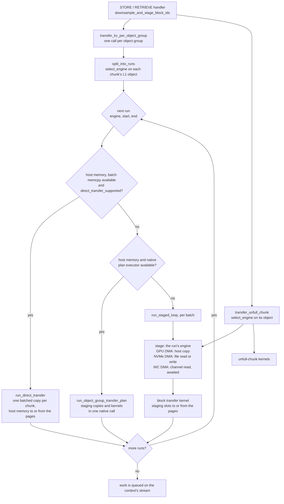

# LMCache-Driven Transfer: Engines and Copy Paths

Package: `lmcache/v1/multiprocess/object_group_transfer/` (eligibility and
planning) driven from `lmcache/v1/multiprocess/modules/lmcache_driven_transfer.py`
(the STORE/RETRIEVE handlers), native side `csrc/cuda/mp_mem_kernels.cu`.

| Module | Holds |
|---|---|
| `planning.py` | batching, block-id downsampling, skip arithmetic shared by every path |
| `direct_copy.py` | the `direct` path: eligibility and planner |
| `staged.py` | the `kernel` path: as one native plan, or one batch at a time (`run_staged_loop`) |
| `engines.py` | which transfer engine moves an object, the split of a group into same-engine runs, and `stage`: the engines' one operation |
| `gpu_dma.py` | the GPU DMA engine's `stage`: host/GPU copies queued on the stream |
| `nvme_dma.py` | the NVMe DMA engine's `stage`: GDS slab reads and writes queued on the stream |
| `nic_dma.py` | the NIC DMA engine's `stage`: transfer-channel reads |
| `dispatch.py` | `transfer_kv_per_object_group`: picks each run's copy path |
| `unfull_chunk.py` | the request's trailing unfull chunk |

Callers import the public names from the package itself.

## Transfer engines

The engine is chosen per object, from its L1 type, so one storage-backed
chunk does not move its whole object group off the fast path.

An engine does one thing: `stage(engine, cache_context, objects, staging
regions, direction)` moves bytes between objects and staging regions. It
does not know whether a region holds a full chunk or the unfull chunk, nor
which blocks it maps to; the caller owns the kernels. So the full-chunk loop
and `transfer_unfull_chunk` use the same engines:

```
retrieve:  stage(engine, objects -> regions)   then the caller's kernels
store:     the caller's kernels                then stage(engine, regions -> objects)
```

Each engine has its own module with one `stage` function: `gpu_dma.py` queues
host/GPU copies and `nvme_dma.py` queues GDS slab reads and writes, both on the
stream; `nic_dma.py` runs transfer-channel reads. They are separate because
their tuning and failure handling differ, even where the code is short today.

| L1 object | Engine | `stage` | Full-chunk copy path |
|---|---|---|---|
| Host memory (DRAM, DevDAX) | GPU DMA | host/GPU copy on the stream | `direct` when usable, else `kernel` (native plan, or per batch without it) |
| Storage-backed (`GDSMemoryObject`) | NVMe DMA | file read or write on the stream | `kernel`, per batch |
| Owned by a peer (`BorrowedMemoryObj`) | NIC DMA | transfer-channel read, awaited; retrieve only | `kernel`, per batch |

`split_into_runs` cuts the group's chunks into consecutive runs of one engine
and each copy path gets its run as a `[start, end)` chunk range over the full
object list, so block-id positions stay absolute. Runs are consecutive because
a kernel launch takes its batch's block ids as one contiguous slice. A missing
entry (a chunk outside the sliding window, or a failed allocation on store)
joins the next object's run.

```
objects:  host host | storage storage | host host
runs:     GPU DMA [0,2) -> NVMe DMA [2,4) -> GPU DMA [4,6)   (in order, one stream)
```

A group whose objects are all of one type is a single run, which is what
every single-L1 deployment sees: the result is the same as before the split.

### Dispatch workflow

`transfer_kv_per_object_group` is called once per object group. It splits
the chunks into runs and picks each run's copy path. The direct copy and the
native plan bypass `stage`, so only host-memory runs may take them.



- **Order.** Runs are issued in chunk order on the context's one stream, so
  the staging buffer is never used by two runs at once.
- **Host memory** is decided per run, not per group: a run of host-memory
  chunks next to a storage-backed run still takes the direct path.
- **NVMe DMA and NIC DMA** always use the per-batch loop: their staging step
  is a file or channel read, which the native plan cannot issue.
- **Skipped chunks.** On retrieve the loop does not stage the chunks of a
  batch that `skip_first_n_tokens` covers entirely; the kernel skips them.
- **NIC DMA** blocks the caller until its reads finished; the other two
  return as soon as their work is queued.
- **Store.** The loop queues the kernels, then stages out. `stage` raises
  `ValueError` for NIC DMA, so a store to a peer's object fails.
- **Errors.** A retrieve raises on a missing object; a store skips the batch
  that contains one.
- **Partial work.** When a later run raises, the earlier runs are already
  queued. The handler marks the retrieve failed, so the blocks are not used.
- **One thread per context.** The handlers' client affinity makes one thread
  drive a context's stream and staging slots; the engines rely on it.

### NIC DMA

A peer's object has no local bytes. At retrieve it reads itself
(`BorrowedMemoryObj.read_into(region_id, offset)`) into its region of the
cache context's staging buffer, the same regions the other engines stage
into, so the platform layer needs nothing extra for it. This holds for full
chunks and for the unfull chunk alike.

```
peer DRAM --read_into--> staging slot --kernel--> paged KV
```

The read is not ordered by the CUDA stream, so `nic_dma.stage` orders it
from the host, once per call (one batch, or the unfull chunk):

1. synchronize the stream: an earlier transfer, or the kernel of the
   previous batch, may still be using the staging buffer;
2. start one read per object and wait until all of them settled.

The caller queues the kernel after `stage` returns.

A failed read aborts the retrieve, but only after every read of its call
settled, so no read is left landing in a region that is used again. The wait
has no deadline, so the transport that implements `PendingRead` must stop
every read; reads still pending after 5 s are logged once.
With one set of slots the reads of batch `n+1` cannot overlap the kernel of
batch `n`.

Before a read starts, the engine checks that the object's size equals its
staging region's and that the region lies inside the registered one.

The engine has to know which channel region the staging buffer is:
`nic_dma.set_staging_region(cache_context, StagingRegion(region_id,
base_ptr, size))`, undone by `clear_staging_region`. Whoever registers the
buffer with the transfer channel calls it, and must check that every staging
slot starts on the channel's alignment (the object sizes are multiples of
it). An unfull-chunk object with lead blocks stages at the start of the
buffer; its size need not be a multiple of the alignment, so the channel
read must not write past the object's end. Nothing registers the buffer yet,
and no object is bound to a peer read yet: both come with the borrowing L2
adapter. Until then the path is exercised by tests only.

## Problem

STORE/RETRIEVE moves each chunk between a pinned host memory object
(`[kv, layer, tokens, nh*hs]`) and the engine's paged KV buffers. The
default path stages every chunk through a GPU temp buffer with
`cudaMemcpyAsync` and scatters/gathers it with the
`multi_layer_block_kv_transfer` kernel (grid `(kv, blocks, layers)`, one
thread block per paged block). When blocks are huge and few -- Kimi Linear
with vLLM's 1024-token MLA pages has 7 blocks of 1.1 MB per chunk -- the
kernel runs 7 thread blocks and moves data at ~24 GB/s, about half the
staging copy's line rate, so the kernel dominates the transfer.

## Two copy paths

| | `kernel` (fallback) | `direct` (preferred when usable) |
|---|---|---|
| Mechanism | `cudaMemcpyAsync` to temp buffer + block kernel | one `cudaMemcpyBatchAsync` per chunk, host <-> pages |
| GPU resources | temp buffer (4 slots), SMs | copy engine only |
| CPU cost | ~1 launch + 1 copy per chunk | ~0.6 us per (kv, layer, block) entry |
| Layouts | all `EngineKVFormat`s | token-major, contiguous block: formats 0, 1, 2, 3, 4, 5, 9, 11, 13, 18 |
| Requirements | any CUDA / HIP | CUDA runtime and driver >= 12.8, or ROCm/HIP >= 7.15 (opt-in) |

On ROCm the direct path is **opt-in**: it is built when HIP >= 7.15 but stays
disabled at runtime unless `LMCACHE_ROCM_ENABLE_BATCH_MEMCPY` is set to a
non-zero value. The compile-time `HIP_VERSION` guard cannot prove the op is
functional -- some HIP builds link `hipMemcpyBatchAsync` but return
`hipErrorNotSupported` at runtime -- so `batch_memcpy_supported()` requires the
explicit opt-in before selecting the copy-engine path. Even when opted in, the
probe additionally requires
`hipDeviceAttributeCanUseHostPointerForRegisteredMem == 1`: the batched copy
engine dereferences the `hipHostRegister`'d host operand directly, so on
configs where a registered host VA is not device-addressable (attribute `0`,
observed on some MI300/MI355 ROCm builds) the batched D2H/H2D copy faults with a
GPU memory access fault, and the connector must fall back to the staging kernel.
Some ROCm builds report the attribute as `0` even though the registered host VA
is device-addressable (e.g. MI355X, ROCm 10 / HIP 7.15). On such platforms,
after `tests/v1/multiprocess/test_direct_copy_transfer_gpu.py` and
`test_direct_copy_planner_gpu.py` pass, set `LMCACHE_ROCM_FORCE_BATCH_MEMCPY`
to a non-zero value (together with `LMCACHE_ROCM_ENABLE_BATCH_MEMCPY`) to skip
the attribute check.
CUDA behaviour is unchanged (gated purely on the 12.8 runtime/driver check).

Every eligible format is affine in (kv plane, layer, block):
`address = base(kv, layer) + kv * kv_stride + layer * layer_stride +
block_id * block_stride`. `resolve_block_addressing` in
`mp_mem_kernels.cu` fills this table once per kernel group with strides
mirroring the kernel's `calculate_engine_global_offset` (so the padded
`block_stride_elems` of pool-shared MLA rows is honoured the same way); the
per-entry loop then has no format branches. Eligibility depends on the
geometry as well as the format, so `direct_copy_format_supported` takes the
kernel group's shape desc. An HND block (heads before tokens) with a single
head, `[1, bs, hs]`, holds the same bytes as the NHD block `[bs, 1, hs]`, so
formats 6, 7, 8 and 12 share the addressing of their NHD twins 1, 2, 0 and 13 when
`nh == 1` (DeepSeek-V4's latent cache, or any GQA model at one KV head per
rank). Multi-head HND, blocked-scale and per-layer (K, V)-tuple layouts are
rejected because their paged block is not one contiguous `[bs, nh*hs]` run.

Host ranges are split at `LazyMemoryAllocator.PIN_CHUNK_SIZE` boundaries of
the allocator's virtual offset, exactly as `lmcache_memcpy_async` does: each
64 MB pin chunk is a separate `cudaHostRegister` region and a copy spanning
two of them fails with `cudaErrorInvalidValue`.

## Flow (direct path)

```
handler (store/retrieve)
  |- downsample_and_stage_block_ids  -> device tensors (kernel path)
  |                                   + mutated host lists (direct path)
  `- transfer_kv_per_object_group(..., block_ids_host)
       `- for each run of host-memory chunks
            |- batch_memcpy_available      -> build + driver support (once, at import)
            |- direct_transfer_supported   -> per run
            `- run_direct_transfer
                 |- DirectCopyGroupSpec per kernel group: host layer pointers,
                 |  shape desc, format, slots/chunk, byte offset in object,
                 |  host block ids
                 |- DirectCopyObject per chunk: host ptr, allocator offset,
                 |  size, chunk index, per-group skip blocks
                 `- device_ops.execute_direct_copy_transfer (one GIL release)
                      for each object: expand entries -> split at pin
                      boundaries -> cudaMemcpyBatchAsync(stream)
```

Window skipping (`num_objects_to_skip`) and `skip_first_n_tokens` follow
the same rules as the staged planner, evaluated per chunk (the direct path
has no batch of 4; the skip is `recalculate_blocks_to_skip` of the chunk's
own skipped tokens).

## Selection

There is no configuration knob: the direct path is taken whenever it can be.
`batch_memcpy_available` reports the build- and driver-level support, resolved
once at import (`execute_direct_copy_transfer` exported, `batch_memcpy_supported()`
true), and `direct_transfer_supported` then checks the run of host-memory
chunks itself -- host block ids present, no GDS-backed object, and every
kernel group of the object group on an eligible layout with a per-layer block
of at least 32 KB. Anything unmet falls back to `kernel`; an ineligible layout
or a block under the floor is logged once per layout and geometry, the rest at
debug level.

Callers that must stay on the kernel path pass no `block_ids_host`, which is
how the staged path is exercised in tests and how `qstore` keeps its existing
behaviour.

## Cost model

Measured on H200 (CUDA 13.0, driver 580): a batch entry costs ~0.6 us of
CPU and the copy engine starts only after the call returns, so per-chunk
time is `max(entries * 0.6 us, bytes / 55 GB/s)`. Break-even is ~34 KB per
entry; below that the kernel path is faster (see the floor table below).
For Kimi Linear's 1.1 MB blocks the direct path cut a 128k-token
store from 26.6 ms to 19.7 ms per rank (x0.74) and retrieve to x0.91.

`direct_transfer_supported` also applies a size floor: a kernel group whose
paged block is below 32 KB per layer (`bs * nh * hs * element_size`) stays on
the kernel path (the ~34 KB break-even rounded down to the smallest size
that measured faster). Measured through `transfer_kv_per_object_group` on H200
(256-token chunks, 32 per call), store time direct / kernel:

| per-layer block | 1-D (one tensor per layer) | 2-D (layers packed in the block) |
|---|---|---|
| 4 KB | 4.0x | |
| 8 KB | 2.7x | |
| 16 KB | 1.5-1.7x | |
| 18.7 KB (DeepSeek-V4.1 sliding window) | | 1.5x |
| 32-128 KB | 0.87-0.94x | 1.12-1.36x (37-131 KB) |

Common GQA deployments fall under the floor once the KV heads are split
across ranks: Step-3.7-Flash at TP 4 (16 KB bf16, 8 KB fp8) measured 1.7x and
3.0x, MiMo-V2.5 at TP 4 (20 KB) 1.5x, gpt-oss-120b at TP 8 (8 KB) 2.3x.

Packed layouts above the floor still take the 2-D path; the copy engine
moves strided 2-D rows more slowly than 1-D entries of the same size
(42.5 vs 50.6 GB/s at 131 KB rows), so they can lose to the kernel path.

## Testing

- `tests/v1/multiprocess/test_direct_copy_transfer_gpu.py`: bit-exact
  parity with the kernel path for every eligible format, both directions,
  multi-chunk plans with a skipped block prefix, a two-group object, padded
  MLA stride, and pin-boundary splitting; single-head HND layouts (including
  DeepSeek-V4.1's packed sliding-window block); rejection of multi-head HND
  layouts and out-of-range ids.
- `tests/v1/multiprocess/test_direct_transfer_dispatch.py`: eligibility and
  dispatch (CPU only).
- `tests/v1/multiprocess/test_transfer_engines.py`: object type to engine,
  the split into runs (including missing entries), and the routing of each
  run with its chunk range (CPU only).
- `tests/v1/multiprocess/test_nic_dma_transfer.py`: the NIC engine's
  ordering of reads and kernels, its failure paths and the unregistered
  staging buffer (CPU only, fakes).
- `tests/v1/multiprocess/test_direct_copy_planner_gpu.py`: a group split
  across engines gives the same bytes as one engine moving it whole, and a
  retrieve of peer-owned chunks gives the same pages as a retrieve from host
  memory.
