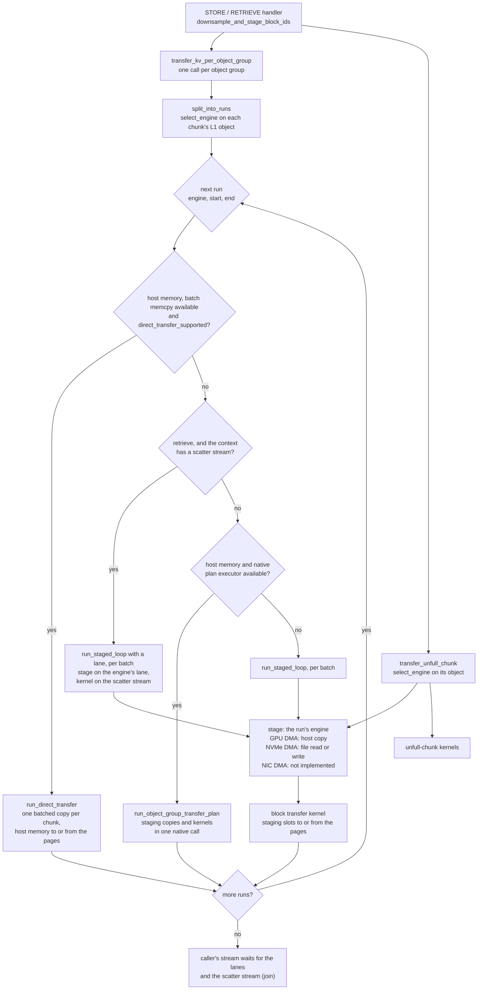

# LMCache-Driven Transfer: Engines and Copy Paths

Package: `lmcache/v1/multiprocess/object_group_transfer/` (eligibility and
planning) driven from `lmcache/v1/multiprocess/modules/lmcache_driven_transfer.py`
(the STORE/RETRIEVE handlers), native side `csrc/cuda/mp_mem_kernels.cu`.

| Module | Holds |
|---|---|
| `planning.py` | batching, block-id downsampling, skip arithmetic shared by every path |
| `direct_copy.py` | the `direct` path: eligibility and planner |
| `staged.py` | the `kernel` path: as one native plan, or one batch at a time (`run_staged_loop`): on the caller's stream, or with a staging lane over a load stream and the scatter stream |
| `engines.py` | which transfer engine moves an object, the split of a group into same-engine runs, the `DMAEngine` protocol and `stage`, which calls the engine |
| `gpu_dma.py` | `GpuDmaEngine`: host/GPU copies queued on the stream |
| `nvme_dma.py` | `NvmeDmaEngine`: GDS slab reads and writes queued on the stream |
| `nic_dma.py` | `NicDmaEngine`, a placeholder: its `stage` raises `NotImplementedError` |
| `dispatch.py` | `transfer_kv_per_object_group`: picks each run's copy path, and ties a retrieve's load and scatter streams to the caller's stream (gate and join) |
| `unfull_chunk.py` | the request's trailing unfull chunk |

Platform side: `lmcache/v1/platform/base/staging_lane.py` (`StagingLane`,
`BankSignals`) and `BaseCacheContext.get_scatter_stream` /
`get_staging_lane`.

Callers import the public names from the package itself.

## Transfer engines

The engine is chosen per object, from its L1 type, so one storage-backed
chunk does not move its whole object group off the fast path.

An engine does one thing: `stage(objects, staging regions, direction)` moves
bytes between objects and staging regions. It
does not know whether a region holds a full chunk or the unfull chunk, nor
which blocks it maps to; the caller owns the kernels. So the full-chunk loop
and `transfer_unfull_chunk` use the same engines:

```
retrieve:  stage(engine, objects -> regions)   then the caller's kernels
store:     the caller's kernels                then stage(engine, regions -> objects)
```

Every engine implements the `DMAEngine` protocol, which has that one method,
so the three keep the same interface. Each is a class in its own module:
`GpuDmaEngine` queues host/GPU copies and `NvmeDmaEngine` queues GDS slab
reads and writes, both on the stream. `engines.stage(engine, ...)` looks the
engine up and calls it. They are separate because their tuning and failure handling differ,
even where the code is short today. `nic_dma.py` is a placeholder: objects a
peer owns select `NicDmaEngine`, whose `stage` raises
`NotImplementedError` until the engine is added.

| L1 object | Engine | `stage` | Full-chunk copy path |
|---|---|---|---|
| Host memory (DRAM, DevDAX) | GPU DMA | host/GPU copy on the stream | `direct` when usable, else `kernel`: on the engine's lane on retrieve; native plan (or per batch without it) on store |
| Storage-backed (`GDSMemoryObject`) | NVMe DMA | file read or write on the stream | `kernel`, per batch: on the engine's lane on retrieve, on the caller's stream on store |
| Owned by a peer (`BorrowedMemoryObj`) | NIC DMA | not implemented; raises `NotImplementedError` | none |

`split_into_runs` cuts the group's chunks into consecutive runs of one engine
and each copy path gets its run as a `[start, end)` chunk range over the full
object list, so block-id positions stay absolute. Runs are consecutive because
a kernel launch takes its batch's block ids as one contiguous slice. A missing
entry (a chunk outside the sliding window, or a failed allocation on store)
joins the next object's run.

```
objects:  host host | storage storage | host host
runs:     GPU DMA [0,2) -> NVMe DMA [2,4) -> GPU DMA [4,6)   (issued in order)
```

A group whose objects are all of one type is a single run, which is what
every single-L1 deployment sees: the result is the same as before the split.

### Dispatch workflow

`transfer_kv_per_object_group` is called once per object group. It splits
the chunks into runs and picks each run's copy path. The direct copy and the
native plan bypass `stage`, so only host-memory runs may take them. On
retrieve, a staged run goes to its engine's lane when the context has a
scatter stream (see [Load lanes and the scatter stream](#load-lanes-and-the-scatter-stream)).



- **Order.** Runs are issued in chunk order. On the caller's stream the
  context's one staging buffer is never used by two runs at once; on a lane
  the bank signals keep a load off a bank that is still being scattered.
- **Host memory** is decided per run, not per group: a run of host-memory
  chunks next to a storage-backed run still takes the direct path.
- **NVMe DMA** always stages per batch: its staging step is a file
  read or write, which the native plan cannot issue.
- **Skipped chunks.** On retrieve the loop does not stage the chunks of a
  batch that `skip_first_n_tokens` covers entirely; the kernel skips them.
- **Store.** The loop queues the kernels, then stages out.
- **NIC DMA** is not implemented: a run of objects a peer owns raises
  `NotImplementedError`, so the transfer fails.
- **Errors.** A retrieve raises on a missing object; a store skips the batch
  that contains one.
- **Partial work.** When a later run raises, the earlier runs are already
  queued. The handler marks the retrieve failed, so the blocks are not used.
- **One thread per context.** The handlers' client affinity makes one thread
  drive a context's streams, staging slots and lanes; the engines rely on it.

### Load lanes and the scatter stream

A staged retrieve has two stream-ordered steps per batch: the load (L1
object to staging buffer) and the scatter (block kernel, staging buffer to
the paged KV blocks). On one stream they alternate, so the copy engine (or
the drive) idles during every scatter and the kernel idles during every
load, and a slow engine holds up the chunks of a fast one.

A context that returns a stream from `get_scatter_stream()` (CUDA does)
gives each engine a **staging lane**: its own load stream and two staging
banks, each the size of the context's staging buffer. Batches alternate
between the banks, and all block kernels run on the one scatter stream:

```
GPU DMA lane   | load b0 -> bank 0 | load b1 -> bank 1 | load b2 -> bank 0 |
NVMe DMA lane  | read c0 -> bank 0 ............ | read c1 -> bank 1 ......
scatter stream |                   | scatter b0 | scatter b1 | scatter c0 | ...
```

Two signals per bank order the two streams (`BankSignals`):

| Signal | Queued on | Waited on | Meaning |
|---|---|---|---|
| staged | load stream, after the batch's loads | scatter stream, before the batch's kernels | the bank holds the batch |
| free | scatter stream, after the batch's kernels | load stream, before the bank's next load | the bank may be overwritten |

The signals outlive a request: the next request's first load into a bank
waits for the previous request's last scatter of it.

Both are stream events: `BankSignals` records an event on one stream and
makes the other wait for it. A doorbell word (`cuStreamWriteValue32` /
`cuStreamWaitValue32`) was tried in their place and dropped: it measured
the same as events for stream-ordered loads (49.2-50.7 against 49.4-50.9
GiB/s for staged host memory), and a wait that a host thread releases can
deadlock (see "Host-thread loads" below).

#### Host-thread loads (NVMe DMA)

A stream-ordered GDS read runs one after another on its stream, so one
request reads one object at a time however many drives hold the slab. The
NVMe engine therefore loads on host threads by default:

```
handler        | wait free(b0) | load b0 ........ | queue scatter b0 | wait free(b1) | load b1 ...
reader threads |               | read c0 | read c2 |                  |               | read c4 | ...
               |               | read c1 | read c3 |                  |               | read c5 | ...
scatter stream |                                   | scatter b0 ..........            |
```

- For a batch whose engine loads on host threads, the staged loop waits
  on the host until the bank is free (`BankSignals.wait_free_on_host`),
  calls `NvmeDmaEngine.load_from_host`, which fans the batch's objects out
  to the reader threads (`GDSContext.read_blocking`, a blocking slab read
  into the registered bank) and returns when all of them have ended, and
  only then queues the "staged" signal, the block kernels and the "free"
  signal on the scatter stream. Nothing is queued on the lane's stream. The
  next batch reads into the other bank while this one scatters.
- **The handler waits for the reads.** Handler time for a GDS run is about
  its wall time, as with the stream-ordered read under cuFile compat mode.
- **Why the kernels are not queued ahead.** An earlier version queued the
  kernels first, behind a doorbell word (`cuStreamWaitValue32`) that a host
  thread wrote when the reads had returned, so the handler returned at
  once. It deadlocked: `cuFileRead` in compat mode copies the bytes to the
  device on an internal stream and synchronizes it, and the driver, which
  cannot see the order such a wait imposes, sometimes ran that copy behind
  a pending wait. The wait needed the read to return and the read needed
  the wait released (found on an H200 with two reader threads, alternating
  host/GDS runs; writing the words by hand released the stuck read). So no
  stream ever waits for a host thread: device work for a batch is queued
  after its reads have returned. A peer-to-peer GPU read measured the same
  way (28.9-30.9 GiB/s with events, 28.9-30.8 with the doorbell), so the
  early return is the only thing given up.
- **Default.** Two reader threads; `LMCACHE_GDS_READ_THREADS` changes the
  number and `0` returns to the stream-ordered read, as does a GDS backend
  without a blocking read (only cuFile implements it). At most one batch
  (four objects) is read at a time, so more than four threads gain nothing.
- **Failure.** A failed or short read raises `OSError` from the retrieve
  call after the other reads of the batch have ended; no kernel is queued
  for that batch. A read that never returns holds the handler, as a
  stream-ordered read in compat mode does.
- **Measured** (H200 shared with another job, cuFile compat mode, 64
  chunks, 11-27 MiB objects, pages identical). One NVMe drive, limit 5.9
  GiB/s: GDS 4.3-5.0 GiB/s with one thread, 5.2-6.0 with two (4.1-4.4
  stream-ordered); alternating host/GDS runs 9.9-11.6 with two. Four
  drives, one slab on each (a benchmark-only setup: LMCache opens one slab
  per process): GDS 7.3-9.1 with two threads and 12.0-16.4 with four;
  alternating runs 13.4-15.9 and 20.5-26.2.

The caller's stream is where the request is ordered (the engine's event is
waited on it; the completion event and the lock release are queued on it),
so `dispatch.py` ties the other streams to it at both ends:

```
caller stream  | wait engine | gate ............................. | join | done
load stream    |   load b0   | load b1 | load b2 |                   ^
scatter stream |      (gate) | scatter b0 | scatter b1 | scatter b2  |
```

- **Gate.** The scatter stream waits for an event recorded on the caller's
  stream, so no kernel runs before the block IDs are staged and the engine
  has released the blocks. Loads only write staging banks and start at once.
- **Join.** Before `transfer_kv_per_object_group` returns, the caller's
  stream waits for every lane the call used and for the scatter stream, also
  when the call raises: a queued load must finish before the handler
  releases the objects it reads.
- **Direct copy** runs stay on the caller's stream. They need no staging,
  and because the join comes at the end of the call they overlap with the
  staged runs of the other engines.
- **Store** and the **unfull tail chunk** stay on the caller's stream with
  the context's own staging buffer.
- **Failure.** Once a batch's "staged" signal is queued its "free" signal is
  queued too (`finally`), so a failed kernel launch cannot leave the bank's
  next load waiting forever.
- **Cost.** A lane is created on its first staged retrieve: one stream and
  two banks of GPU memory (for a 256-token chunk of an 18 MiB object, 72 MiB
  per bank). A deployment whose retrieves all take the direct copy creates
  none. The NVMe lane's banks are registered with the GDS library on the
  lane's stream.
- **Phase timing.** `MP_TRANSFER_PHASE_SAMPLES` is produced by the native
  plan only, so a staged host-memory retrieve on a lane reports no phase
  samples; store still does.

Measured on an H200 (64 chunks, batch 4, staged path, median of 9; GDS in
cuFile compat mode on one NVMe drive): host memory 45-48 -> 49-51 GiB/s,
GDS unchanged at 4.2-4.4 GiB/s (the drive is the limit), alternating
host/GDS runs 7.8-8.0 -> 8.2-8.5 GiB/s. Queueing on two streams from Python
costs handler time for host memory: 0.8-1.2 ms -> 2.1-3.0 ms per request
against the native plan.

### NIC DMA

A peer's object (`BorrowedMemoryObj`) has no local bytes. The planned engine
reads it into the object's region of the staging buffer over the transfer
channel (`read_into(region_id, offset)`), then the block kernel runs as for
the other engines:

```
peer DRAM --read_into--> staging slot --kernel--> paged KV
```

That engine is not part of this package yet. `NicDmaEngine.stage` raises
`NotImplementedError`, and `select_engine` already routes peer-owned objects
to it so the dispatch does not change when it arrives (RFC #6399).

## Problem

STORE/RETRIEVE moves each chunk between a pinned host memory object
(`[kv, layer, tokens, nh*hs]`) and the engine's paged KV buffers. The
default path stages every chunk through a GPU temp buffer with
`cudaMemcpyAsync` and scatters/gathers it with the
`multi_layer_block_kv_transfer` kernel (grid `(kv, blocks, layers)`, one
thread block per paged block). When blocks are huge and few -- Kimi Linear
with vLLM's 1024-token MLA pages has 7 blocks of 1.1 MB per chunk -- the
kernel runs 7 thread blocks and moves data at ~24 GB/s, about half the
staging copy's line rate, so the kernel dominates the transfer.

## Two copy paths

| | `kernel` (fallback) | `direct` (preferred when usable) |
|---|---|---|
| Mechanism | `cudaMemcpyAsync` to temp buffer + block kernel | one `cudaMemcpyBatchAsync` per chunk, host <-> pages |
| GPU resources | temp buffer (4 slots), SMs | copy engine only |
| CPU cost | ~1 launch + 1 copy per chunk | ~0.6 us per (kv, layer, block) entry |
| Layouts | all `EngineKVFormat`s | token-major, contiguous block: formats 0, 1, 2, 3, 4, 5, 9, 11, 13, 18 |
| Requirements | any CUDA / HIP | CUDA runtime and driver >= 12.8, or ROCm/HIP >= 7.15 (opt-in) |

On ROCm the direct path is **opt-in**: it is built when HIP >= 7.15 but stays
disabled at runtime unless `LMCACHE_ROCM_ENABLE_BATCH_MEMCPY` is set to a
non-zero value. The compile-time `HIP_VERSION` guard cannot prove the op is
functional -- some HIP builds link `hipMemcpyBatchAsync` but return
`hipErrorNotSupported` at runtime -- so `batch_memcpy_supported()` requires the
explicit opt-in before selecting the copy-engine path. Even when opted in, the
probe additionally requires
`hipDeviceAttributeCanUseHostPointerForRegisteredMem == 1`: the batched copy
engine dereferences the `hipHostRegister`'d host operand directly, so on
configs where a registered host VA is not device-addressable (attribute `0`,
observed on some MI300/MI355 ROCm builds) the batched D2H/H2D copy faults with a
GPU memory access fault, and the connector must fall back to the staging kernel.
Some ROCm builds report the attribute as `0` even though the registered host VA
is device-addressable (e.g. MI355X, ROCm 10 / HIP 7.15). On such platforms,
after `tests/v1/multiprocess/test_direct_copy_transfer_gpu.py` and
`test_direct_copy_planner_gpu.py` pass, set `LMCACHE_ROCM_FORCE_BATCH_MEMCPY`
to a non-zero value (together with `LMCACHE_ROCM_ENABLE_BATCH_MEMCPY`) to skip
the attribute check.
CUDA behaviour is unchanged (gated purely on the 12.8 runtime/driver check).

Every eligible format is affine in (kv plane, layer, block):
`address = base(kv, layer) + kv * kv_stride + layer * layer_stride +
block_id * block_stride`. `resolve_block_addressing` in
`mp_mem_kernels.cu` fills this table once per kernel group with strides
mirroring the kernel's `calculate_engine_global_offset` (so the padded
`block_stride_elems` of pool-shared MLA rows is honoured the same way); the
per-entry loop then has no format branches. Eligibility depends on the
geometry as well as the format, so `direct_copy_format_supported` takes the
kernel group's shape desc. An HND block (heads before tokens) with a single
head, `[1, bs, hs]`, holds the same bytes as the NHD block `[bs, 1, hs]`, so
formats 6, 7, 8 and 12 share the addressing of their NHD twins 1, 2, 0 and 13 when
`nh == 1` (DeepSeek-V4's latent cache, or any GQA model at one KV head per
rank). Multi-head HND, blocked-scale and per-layer (K, V)-tuple layouts are
rejected because their paged block is not one contiguous `[bs, nh*hs]` run.

Host ranges are split at `LazyMemoryAllocator.PIN_CHUNK_SIZE` boundaries of
the allocator's virtual offset, exactly as `lmcache_memcpy_async` does: each
64 MB pin chunk is a separate `cudaHostRegister` region and a copy spanning
two of them fails with `cudaErrorInvalidValue`.

## Flow (direct path)

```
handler (store/retrieve)
  |- downsample_and_stage_block_ids  -> device tensors (kernel path)
  |                                   + mutated host lists (direct path)
  `- transfer_kv_per_object_group(..., block_ids_host)
       `- for each run of host-memory chunks
            |- batch_memcpy_available      -> build + driver support (once, at import)
            |- direct_transfer_supported   -> per run
            `- run_direct_transfer
                 |- DirectCopyGroupSpec per kernel group: host layer pointers,
                 |  shape desc, format, slots/chunk, byte offset in object,
                 |  host block ids
                 |- DirectCopyObject per chunk: host ptr, allocator offset,
                 |  size, chunk index, per-group skip blocks
                 `- device_ops.execute_direct_copy_transfer (one GIL release)
                      for each object: expand entries -> split at pin
                      boundaries -> cudaMemcpyBatchAsync(stream)
```

Window skipping (`num_objects_to_skip`) and `skip_first_n_tokens` follow
the same rules as the staged planner, evaluated per chunk (the direct path
has no batch of 4; the skip is `recalculate_blocks_to_skip` of the chunk's
own skipped tokens).

## Selection

There is no configuration knob: the direct path is taken whenever it can be.
`batch_memcpy_available` reports the build- and driver-level support, resolved
once at import (`execute_direct_copy_transfer` exported, `batch_memcpy_supported()`
true), and `direct_transfer_supported` then checks the run of host-memory
chunks itself -- host block ids present, no GDS-backed object, and every
kernel group of the object group on an eligible layout with a per-layer block
of at least 32 KB. Anything unmet falls back to `kernel`; an ineligible layout
or a block under the floor is logged once per layout and geometry, the rest at
debug level.

Callers that must stay on the kernel path pass no `block_ids_host`, which is
how the staged path is exercised in tests and how `qstore` keeps its existing
behaviour.

## Cost model

Measured on H200 (CUDA 13.0, driver 580): a batch entry costs ~0.6 us of
CPU and the copy engine starts only after the call returns, so per-chunk
time is `max(entries * 0.6 us, bytes / 55 GB/s)`. Break-even is ~34 KB per
entry; below that the kernel path is faster (see the floor table below).
For Kimi Linear's 1.1 MB blocks the direct path cut a 128k-token
store from 26.6 ms to 19.7 ms per rank (x0.74) and retrieve to x0.91.

`direct_transfer_supported` also applies a size floor: a kernel group whose
paged block is below 32 KB per layer (`bs * nh * hs * element_size`) stays on
the kernel path (the ~34 KB break-even rounded down to the smallest size
that measured faster). Measured through `transfer_kv_per_object_group` on H200
(256-token chunks, 32 per call), store time direct / kernel:

| per-layer block | 1-D (one tensor per layer) | 2-D (layers packed in the block) |
|---|---|---|
| 4 KB | 4.0x | |
| 8 KB | 2.7x | |
| 16 KB | 1.5-1.7x | |
| 18.7 KB (DeepSeek-V4.1 sliding window) | | 1.5x |
| 32-128 KB | 0.87-0.94x | 1.12-1.36x (37-131 KB) |

Common GQA deployments fall under the floor once the KV heads are split
across ranks: Step-3.7-Flash at TP 4 (16 KB bf16, 8 KB fp8) measured 1.7x and
3.0x, MiMo-V2.5 at TP 4 (20 KB) 1.5x, gpt-oss-120b at TP 8 (8 KB) 2.3x.

Packed layouts above the floor still take the 2-D path; the copy engine
moves strided 2-D rows more slowly than 1-D entries of the same size
(42.5 vs 50.6 GB/s at 131 KB rows), so they can lose to the kernel path.

## Testing

- `tests/v1/multiprocess/test_direct_copy_transfer_gpu.py`: bit-exact
  parity with the kernel path for every eligible format, both directions,
  multi-chunk plans with a skipped block prefix, a two-group object, padded
  MLA stride, and pin-boundary splitting; single-head HND layouts (including
  DeepSeek-V4.1's packed sliding-window block); rejection of multi-head HND
  layouts and out-of-range ids.
- `tests/v1/multiprocess/test_direct_transfer_dispatch.py`: eligibility and
  dispatch (CPU only).
- `tests/v1/multiprocess/test_transfer_engines.py`: object type to engine,
  the split into runs (including missing entries), the routing of each
  run with its chunk range, and the unimplemented NIC engine (CPU only).
- `tests/v1/multiprocess/test_staged_loop.py`: the per-batch loop's chunk
  range, block-id slices, skipped chunks, missing objects and the order of
  staging and kernels (CPU only, fakes).
- `tests/v1/multiprocess/test_pipelined_retrieve.py`: what the staged loop
  queues with a lane on the load and the scatter stream, bank rotation, the bank
  freed after a failed launch, the gate and the join, and when the
  dispatcher uses lanes (CPU only, fakes).
- `tests/v1/platform/test_staging_lane.py`: bank rotation and the bank
  signals, including the host-side wait (CPU only, fakes).
- `tests/v1/multiprocess/test_nvme_host_load.py`: the NVMe engine's
  host-thread load: when it applies, and that it returns or raises only
  once every read of the batch has ended (CPU only, fakes).
- `tests/v1/gpu_connector/test_gds_context.py` (`TestReadBlocking`): the
  blocking read's split at region boundaries and the short-read error.
- `tests/v1/multiprocess/test_direct_copy_planner_gpu.py`: a group split
  across engines gives the same bytes as one engine moving it whole, with
  the skipped prefix in a direct or a staged run, host runs on the direct
  copy or staged; repeated staged retrieves on one context reuse the
  banks; storage runs loaded by the reader threads.
