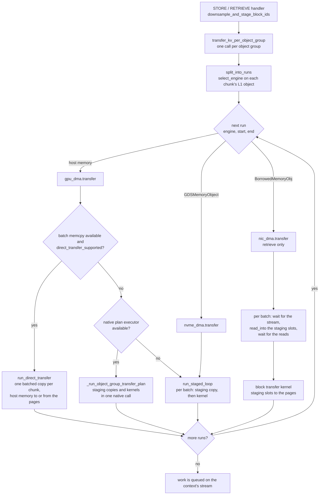

# LMCache-Driven Transfer: Kernel vs Direct Copy Path

Package: `lmcache/v1/multiprocess/object_group_transfer/` (eligibility and
planning) driven from `lmcache/v1/multiprocess/modules/lmcache_driven_transfer.py`
(the STORE/RETRIEVE handlers), native side `csrc/cuda/mp_mem_kernels.cu`.

| Module | Holds |
|---|---|
| `planning.py` | batching, block-id downsampling, skip arithmetic shared by every path |
| `direct_copy.py` | the `direct` path: eligibility and planner |
| `staged.py` | the `kernel` path planned in Python and issued in one native call |
| `staged.py` (cont.) | `run_staged_loop`: the `kernel` path issued one batch at a time |
| `engines.py` | which transfer engine moves a chunk, and the split of a group into same-engine runs |
| `gpu_dma.py`, `nvme_dma.py`, `nic_dma.py` | one entry point per engine |
| `dispatch.py` | `transfer_kv_per_object_group`: runs each engine on its chunks |
| `unfull_chunk.py` | the request's trailing unfull chunk |

Callers import the public names from the package itself.

## Transfer engines

The engine is chosen per chunk, from the type of its L1 object, so one
storage-backed chunk does not move its whole object group off the fast path.

| L1 object | Engine | Copy path |
|---|---|---|
| Host memory (DRAM, DevDAX) | GPU DMA | `direct` when usable, else `kernel` (native plan, or per batch without it) |
| Storage-backed (`GDSMemoryObject`) | NVMe DMA | `kernel`, per batch |
| Owned by a peer (`BorrowedMemoryObj`) | NIC DMA | transfer-channel read into the staging buffer, then the kernel; retrieve only |

`split_into_runs` cuts the group's chunks into consecutive runs of one engine
and each engine gets its run as a `[start, end)` chunk range over the full
object list, so block-id positions stay absolute. Runs are consecutive because
a kernel launch takes its batch's block ids as one contiguous slice. A missing
entry (a chunk outside the sliding window, or a failed allocation on store)
joins the next object's run.

```
objects:  host host | storage storage | host host
runs:     GPU DMA [0,2) -> NVMe DMA [2,4) -> GPU DMA [4,6)   (in order, one stream)
```

A group whose objects are all of one type is a single run, which is what
every single-L1 deployment sees: the result is the same as before the split.

### Dispatch workflow

`transfer_kv_per_object_group` is called once per object group. It only
splits and routes; each engine picks its own copy path for its run.



- **Order.** Runs are issued in chunk order on the context's one stream, so
  the staging buffer is never used by two runs at once.
- **GPU DMA** decides per run, not per group: a run of host-memory chunks
  next to a storage-backed run still takes the direct path.
- **NVMe DMA** always uses the per-batch loop: a storage-backed object's
  staging copy is a file read or write, which the native plan cannot issue.
- **NIC DMA** blocks the caller until its reads finished; the other two
  return as soon as their work is queued.
- **Errors.** A retrieve raises on a missing object; a store skips the batch
  that contains one. A store routed to NIC DMA raises `ValueError`.

### NIC DMA

A peer's object has no local bytes. At retrieve it reads itself
(`BorrowedMemoryObj.read_into(region_id, offset)`) into its slot of the
cache context's staging buffer, the same slots the other engines stage into,
so the platform layer needs nothing extra for it.

```
peer DRAM --read_into--> staging slot --kernel--> paged KV
```

The read is not ordered by the CUDA stream, so `nic_dma.transfer` orders it
from the host, per batch:

1. wait for everything queued on the stream: an earlier transfer, or the
   kernel of the previous batch, may still be using the staging buffer;
2. start one read per chunk and wait until all of them settled;
3. queue the kernel and record its completion event for step 1.

A failed read aborts the retrieve, but only after every read of its batch
settled, so no read is left landing in a slot that is used again. With one
set of slots the reads of batch `n+1` cannot overlap the kernel of batch `n`.

The engine has to know which channel region the staging buffer is:
`nic_dma.set_staging_region(cache_context, StagingRegion(region_id,
base_ptr))`. Whoever registers the buffer with the transfer channel calls it,
and must check that every staging slot starts on the channel's alignment
(the object sizes are multiples of it). Nothing registers the buffer yet,
and no object is bound to a peer read yet: both come with the borrowing L2
adapter. Until then the path is exercised by tests only.

## Problem

STORE/RETRIEVE moves each chunk between a pinned host memory object
(`[kv, layer, tokens, nh*hs]`) and the engine's paged KV buffers. The
default path stages every chunk through a GPU temp buffer with
`cudaMemcpyAsync` and scatters/gathers it with the
`multi_layer_block_kv_transfer` kernel (grid `(kv, blocks, layers)`, one
thread block per paged block). When blocks are huge and few -- Kimi Linear
with vLLM's 1024-token MLA pages has 7 blocks of 1.1 MB per chunk -- the
kernel runs 7 thread blocks and moves data at ~24 GB/s, about half the
staging copy's line rate, so the kernel dominates the transfer.

## Two copy paths

| | `kernel` (fallback) | `direct` (preferred when usable) |
|---|---|---|
| Mechanism | `cudaMemcpyAsync` to temp buffer + block kernel | one `cudaMemcpyBatchAsync` per chunk, host <-> pages |
| GPU resources | temp buffer (4 slots), SMs | copy engine only |
| CPU cost | ~1 launch + 1 copy per chunk | ~0.6 us per (kv, layer, block) entry |
| Layouts | all `EngineKVFormat`s | token-major, contiguous block: formats 0, 1, 2, 3, 4, 5, 9, 11, 13, 18 |
| Requirements | any CUDA / HIP | CUDA runtime and driver >= 12.8, or ROCm/HIP >= 7.15 (opt-in) |

On ROCm the direct path is **opt-in**: it is built when HIP >= 7.15 but stays
disabled at runtime unless `LMCACHE_ROCM_ENABLE_BATCH_MEMCPY` is set to a
non-zero value. The compile-time `HIP_VERSION` guard cannot prove the op is
functional -- some HIP builds link `hipMemcpyBatchAsync` but return
`hipErrorNotSupported` at runtime -- so `batch_memcpy_supported()` requires the
explicit opt-in before selecting the copy-engine path. Even when opted in, the
probe additionally requires
`hipDeviceAttributeCanUseHostPointerForRegisteredMem == 1`: the batched copy
engine dereferences the `hipHostRegister`'d host operand directly, so on
configs where a registered host VA is not device-addressable (attribute `0`,
observed on some MI300/MI355 ROCm builds) the batched D2H/H2D copy faults with a
GPU memory access fault, and the connector must fall back to the staging kernel.
Some ROCm builds report the attribute as `0` even though the registered host VA
is device-addressable (e.g. MI355X, ROCm 10 / HIP 7.15). On such platforms,
after `tests/v1/multiprocess/test_direct_copy_transfer_gpu.py` and
`test_direct_copy_planner_gpu.py` pass, set `LMCACHE_ROCM_FORCE_BATCH_MEMCPY`
to a non-zero value (together with `LMCACHE_ROCM_ENABLE_BATCH_MEMCPY`) to skip
the attribute check.
CUDA behaviour is unchanged (gated purely on the 12.8 runtime/driver check).

Every eligible format is affine in (kv plane, layer, block):
`address = base(kv, layer) + kv * kv_stride + layer * layer_stride +
block_id * block_stride`. `resolve_block_addressing` in
`mp_mem_kernels.cu` fills this table once per kernel group with strides
mirroring the kernel's `calculate_engine_global_offset` (so the padded
`block_stride_elems` of pool-shared MLA rows is honoured the same way); the
per-entry loop then has no format branches. HND (heads before tokens),
blocked-scale and per-layer (K, V)-tuple layouts are rejected by
`direct_copy_format_supported` because their paged block is not one
contiguous `[bs, nh*hs]` run.

Host ranges are split at `LazyMemoryAllocator.PIN_CHUNK_SIZE` boundaries of
the allocator's virtual offset, exactly as `lmcache_memcpy_async` does: each
64 MB pin chunk is a separate `cudaHostRegister` region and a copy spanning
two of them fails with `cudaErrorInvalidValue`.

## Flow (direct path)

```
handler (store/retrieve)
  |- downsample_and_stage_block_ids  -> device tensors (kernel path)
  |                                   + mutated host lists (direct path)
  `- transfer_kv_per_object_group(..., block_ids_host)
       `- gpu_dma.transfer, for each run of host-memory chunks
            |- _HAS_BATCH_MEMCPY_ASYNC     -> build + driver support (once, at import)
            |- direct_transfer_supported   -> per run
            `- run_direct_transfer
                 |- DirectCopyGroupSpec per kernel group: host layer pointers,
                 |  shape desc, format, slots/chunk, byte offset in object,
                 |  host block ids
                 |- DirectCopyObject per chunk: host ptr, allocator offset,
                 |  size, chunk index, per-group skip blocks
                 `- device_ops.execute_direct_copy_transfer (one GIL release)
                      for each object: expand entries -> split at pin
                      boundaries -> cudaMemcpyBatchAsync(stream)
```

Window skipping (`num_objects_to_skip`) and `skip_first_n_tokens` follow
the same rules as the staged planner, evaluated per chunk (the direct path
has no batch of 4; the skip is `recalculate_blocks_to_skip` of the chunk's
own skipped tokens).

## Selection

There is no configuration knob: the direct path is taken whenever it can be.
`_HAS_BATCH_MEMCPY_ASYNC` resolves the build- and driver-level support once at
import (`execute_direct_copy_transfer` exported, `batch_memcpy_supported()`
true), and `direct_transfer_supported` then checks the run of host-memory
chunks itself -- host block ids present, no GDS-backed object, and every
kernel group of the object group on an eligible layout. Anything unmet falls back to `kernel`; an
ineligible layout is logged once per format, the rest at debug level.

Callers that must stay on the kernel path pass no `block_ids_host`, which is
how the staged path is exercised in tests and how `qstore` keeps its existing
behaviour.

## Cost model

Measured on H200 (CUDA 13.0, driver 580): a batch entry costs ~0.6 us of
CPU and the copy engine starts only after the call returns, so per-chunk
time is `max(entries * 0.6 us, bytes / 55 GB/s)`. Break-even is ~34 KB per
entry; below that the kernel path is faster (2x at 16 KB blocks, 7-8x at
4 KB). For Kimi Linear's 1.1 MB blocks the direct path cut a 128k-token
store from 26.6 ms to 19.7 ms per rank (x0.74) and retrieve to x0.91.

Note that eligibility is a layout property, not a size one: a small-block
layout that qualifies structurally will take the direct path and lose to the
kernel path. If that combination shows up in practice, reintroduce a block-
size floor in `direct_transfer_supported`.

## Testing

- `tests/v1/multiprocess/test_direct_copy_transfer_gpu.py`: bit-exact
  parity with the kernel path for every eligible format, both directions,
  multi-chunk plans with a skipped block prefix, a two-group object, padded
  MLA stride, and pin-boundary splitting; rejection of HND layouts and
  out-of-range ids.
- `tests/v1/multiprocess/test_direct_transfer_dispatch.py`: eligibility and
  dispatch (CPU only).
- `tests/v1/multiprocess/test_transfer_engines.py`: object type to engine,
  the split into runs (including missing entries), and the routing of each
  run with its chunk range (CPU only).
- `tests/v1/multiprocess/test_nic_dma_transfer.py`: the NIC engine's
  ordering of reads and kernels, its failure paths and the unregistered
  staging buffer (CPU only, fakes).
- `tests/v1/multiprocess/test_direct_copy_planner_gpu.py`: a group split
  across engines gives the same bytes as one engine moving it whole, and a
  retrieve of peer-owned chunks gives the same pages as a retrieve from host
  memory.
