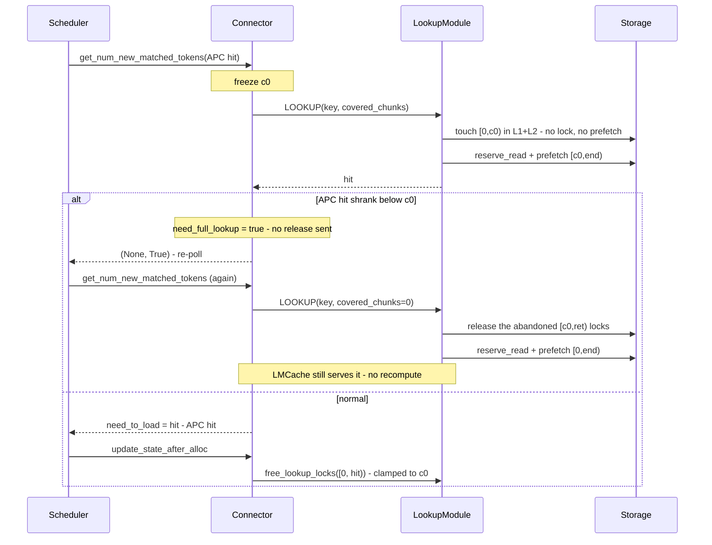

# APC-covered lookup skip (non-pin method)

vLLM's prefix cache (APC) often already holds the first `N` tokens of a
request. LMCache looked them up anyway — read-locking them and pulling them
from L2 into L1 — even though vLLM will never read them.

```
[========= APC already has this =========][==== LMCache loads ====]
0                                         c0                     end
 \__ locked + prefetched for nothing __/
```

There is no flag: the server always honors a covered count, and skips only
what the engine reports as already covered. It advertises
`SKIP_APC_LOOKUP_CAPABILITY` through the existing capability handshake and
the connector sends a count only when it sees that, so an engine talking to
an older server simply never asks for the skip. The two sides therefore
cannot disagree about which prefix was skipped — a server that ignored a
count the engine had already acted on would leave read locks held.

## What changes

`LookupModule.lookup` reads `covered_chunks` from the key's `request_configs`
(carried there to avoid a proto change). For the covered prefix `[0, c0)` it:

- **touches** it in **L1 and L2** — no bytes move, nothing is promoted. Both
  tiers matter: a real load refreshes recency in both, so touching only L1
  would leave the keys cold to L2 and get them evicted.
- **does not** lock or prefetch it. The prefetch covers `chunk_hashes[c0:]`
  only; hit counts shift back to absolute at status time.

So the prefix is no longer *promoted* into L1 on every lookup — that
promotion was the waste. Cache contents are unchanged; only placement is.

`end_session` then touches the **whole** request range in both tiers. The
split above gives one request two recencies — the covered prefix is touched
when the lookup runs, the retrieved tail when it is read — so an L1-only
refresh at the end would leave the prefix the older L2 entry and make the
most-shared data the first thing L2 evicts.

## The shrink race

A WAITING request's APC blocks are unprotected until `allocate_slots`, so the
APC hit can shrink while the lookup is in flight, leaving the frozen `c0`
covering a gap nobody owns.

**This branch does not pin.** It re-looks-up instead — the request is *not*
handed back to vLLM to recompute. Set the sticky `need_full_lookup` (so the
request never skips again — one shrink each, no churn, survives preemption),
reset per-lookup state, and return `(None, True)`. The scheduler re-polls,
this time submitting `covered_chunks = 0`, and LMCache serves the whole
prefix `[0, ret')` from token 0. The request keeps its cache hit; it only
stops skipping.

**The connector sends no release.** `LOOKUP` and `FREE_LOOKUP_LOCKS` share
the server thread pool, so with `max_cpu_workers > 1` a release sent from the
scheduler could land *after* the replacement's `begin_lookup` and rebuild its
range from the *replacement's* session — releasing locks the new lookup still
needs. Instead `lookup()` settles the abandoned result itself, before
`begin_lookup` overwrites the hit length and lock model the release derives
from. A prefetch that is still running is left alone — its locks belong to
the prefetch controller, which settles them in `_finish_request`.

Settling once is not the same as settling exclusively. One lookup can be
released by **several disjoint `FREE_LOOKUP_LOCKS`**: a multi-L1 hit mismatch
frees the over-hit tail, then `update_state_after_alloc` frees the head. So a
FREE *marks* the result released and leaves the lock model in place for the
next one, while `Session.take_prefetch_release()` claims it — atomically, and
only if no FREE got there first. Consuming the model on the first FREE
instead silently drops the second one's locks.

Pinning the covered blocks instead is implemented on the `core/skip-apc-pin`
branch. Non-pin won: no block-pool pressure, no coupling to vLLM's
`BlockPool`, and a shrink costs one wasted lookup rather than held GPU
blocks.

## The invariant

Read locks are anonymous refcounts **shared across prefix-sharing requests**,
so releasing one you never took corrupts another request. Every release goes
through `resolve_prefetched_obj_keys`, whose per-group range start is clamped
to `c0` — it cannot reach into the skipped prefix.

## Flow


